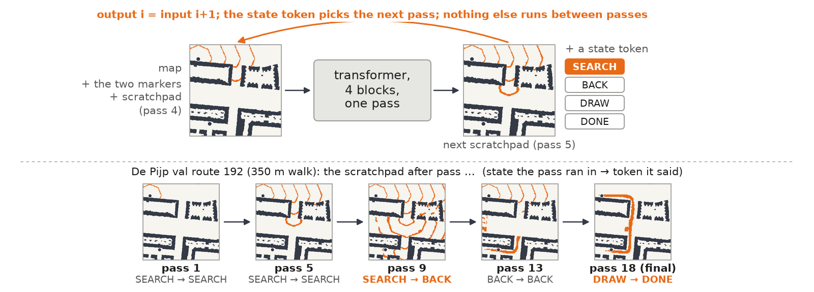
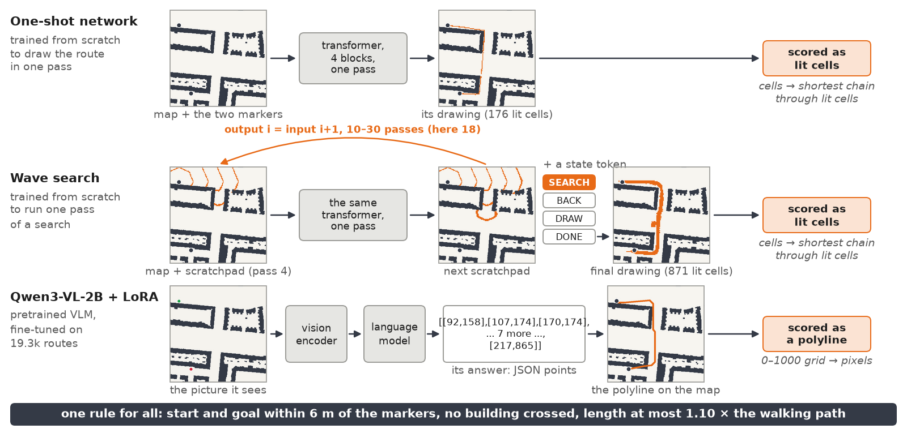
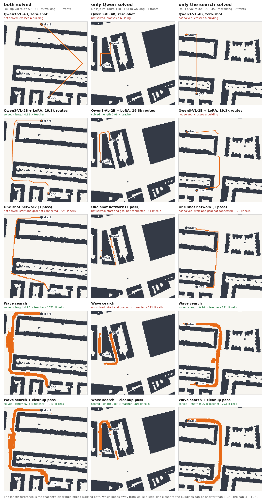

# Spatial reasoning from scratch on real city data: a small transformer runs a path search on its own scratchpad

**Marvin Uhlmann**

*Written with AI assistance (Claude, Anthropic; Cursor Composer). The split of code, experiments and writing is recorded per component in [`AUTHORSHIP.md`](AUTHORSHIP.md).*

## Abstract

We ask what spatial reasoning a small vision transformer learns when its input is not a photograph but spatially aligned data layers of a city, and what it takes. Planes of De Pijp, Amsterdam (buildings, surfaces, noise, places, sunlit hours; 1 m per pixel) go in with markers and condition tokens, and a mask comes out; every target is exact. Transformers of 2–4 blocks and 5–9 M parameters, trained from scratch, climb a seven-level task ladder in one forward pass, up to the shortest path around buildings, where the errors concentrate on routes with several corners. The same kind of 8.9 M-parameter network then runs a breadth-first path search over many passes on its own scratchpad, with its own state token deciding the phase and the stop. Free-running, it solves 73–78 % of held-out De Pijp routes, 60 % in a district never seen in training and 51 % in a synthetic house maze. Under one polyline rule on 500 held-out routes the search solves 76.4 %, Qwen3-VL-2B with LoRA on 19.3k routes 49.6 %, and a one-pass network at the same training budget 37.4 %. Qwen fails on geometry, the search on continuity.


*__Figure 1.__ A path search run by a network on its own scratchpad. A 4-block, 8.9 M-parameter transformer trained only on Amsterdam finds a 431 m walking route through a synthetic house maze it has never seen (512 m window), in 26 passes. Each frame is one pass: the orange cells are the network's whole output, fed back verbatim as its next input; first a wave of fronts spreads from the start, then the way back is drawn from the goal, then a last pass keeps the path. Leftover cells from the search stay on the drawing. Run `c5_r5_wave_nat3_tok01_from_ownp50_L4_16k_g256_b64_zc512` (Section 5).*

---

## 1 Small transformers trained from scratch can be asked spatial questions about a city that have exact answers

This study asks one question: **what spatial reasoning can a small vision transformer learn when the input is not a photo but a set of spatially aligned data layers, and what does it take?**

The input is a 256 m square of Amsterdam drawn as planes: buildings from the 3D building register, surface types from the national base map, the road-noise map, places from OpenStreetMap and Overture, hours of sunshine computed from building heights. Every plane shows a different property of the same ground at the same pixel, one metre per pixel. On top of these the task can place one or two **markers**, points the question refers to ("within 100 m of *here*"). The question itself arrives as two **condition tokens** in front of the image tokens ("food & drink", "within 100 m"). The model answers with a **mask** on a grid of 4 m (later 2 m) cells. Everything in between is a plain transformer of 2 to 4 blocks, 5 to 9 million parameters, trained from scratch on one district. Every task has an exact answer computed from the data, so every number below can be checked.

The tasks form a ladder from "mark the sidewalks" to "draw the shortest path around the buildings from here to there" (Section 3). Section 4 climbs the ladder in one forward pass and finds its limit on routes with many corners. Section 5 lets the same kind of network run a whole search over many passes on its own scratchpad (Figure 1). Section 6 puts a pretrained vision-language model, Qwen3-VL, on the same routes, zero-shot and fine-tuned with LoRA. Section 7 scores the one-shot network, the search and Qwen under one rule. Section 8 collects what was learned, the limitations and the outlook; Section 9 how the work is built, run and released, and who did what.

What this is **not**: no reinforcement learning, one city. The vision-language model appears only as a fine-tuned baseline on the same task, not as the system under study. The one-shot path-finding numbers use a one-cell tolerance on one-cell-wide targets and say so; the search is scored by a route rule stated in full in Section 3, and all route methods are rescored under one polyline rule in Section 7. Section 8.6 lists what is not claimed.

## 2 Related work: the closest line is coordinate-level route tracing on map images, and it lacks exact targets, a validity rule and a difficulty axis

Map questions for vision-language models come in two forms. MapBench [1] poses 1,649 queries on 100 illustrated tourist maps with start and goal as landmark names and expects route directions in language; ground truth is a shortest path on a hand-built scene graph, the metric the ratio of the described path's length to the optimum, and it evaluates existing models (Llama-3.2-11B-Vision, Qwen2-VL-7B, GPT-4o) without training anything. MapTrace [2] is the pixel-level version and the closest relative of Sections 6 and 7: a map image and start/goal coordinates in, an ordered list of coordinates on walkable pixels out, which is the output form of our fine-tuned VLM. Its data are synthetic: an LLM describes maps in twelve categories, an image model renders them, k-means colour clustering guesses the walkable mask, Dijkstra on the pixel graph gives a path, and two LLM critics filter the result, 23k paths on 4k maps. On that data they fine-tune Gemma3-27B (LoRA rank 8) and Gemini 2.5 Flash and evaluate on MapBench's maps with two metrics: NDTW, the dynamic-time-warping distance between predicted and annotated coordinates after normalising by map size (lower is better), and a "success rate" that counts parseable outputs. Fine-tuning moves Gemma from 1.29 to 1.13 NDTW and 88 to 95 % parseable, Flash from 1.29 to 0.87. Their own quality numbers: critic accuracy 76–83 %, human agreement on sample quality κ = 0.36; the largest failure class in their worst predictions is a detour into non-traversable ground (26 %).

Against that line this work differs in five ways. (i) Targets are exact: routes are computed on vector data, so a prediction is right or wrong, where a quarter of MapTrace's paths fail its own critic. (ii) The rule measures validity, not similarity: endpoints, no building crossed, length within 1.10 × of the walking path (Table 2); NDTW can reward a line through a building, and the building crossing is exactly the failure that dominates both their worst cases and our fine-tuned VLM's (Table 6). (iii) Results are reported against difficulty: neither paper breaks results down by path length or number of turns, and the length curve is the whole story of Sections 5 and 7. (iv) Scale: they work at 27B and Gemini; here a 2B VLM reaches 50 % and a 9 M-parameter network with iteration 76 % under one rule, though a larger one-shot VLM was not run and the scale axis is open. (v) What they have and this work lacks is visual diversity: illustrated maps with icons and legends in twelve styles against one city rendered in one clean way. Half of their problem is reading the map; this work isolates the other half, the geometry.

The search of Section 5 has its precedents elsewhere: looped networks that extrapolate to longer problems (Deep Thinking [3, 4]), neural algorithmic reasoning with dense hints [5], and transformers that imitate A* search traces on mazes (Searchformer [6] and successors), which emit the search as text tokens where ours draws it on a scratchpad; training on the network's own drawings is the scheduled-sampling / DAgger idea [7, 8] applied to a scratchpad. The Part-I findings connect to Swin's relative position bias [9], point prompts as tokens [10], shortcut learning [11], attention sinks [12] and task grouping [13]. The full related-work section, with every reference verified and a placing of these results against what each line has shown to work and not to work, is `docs/RELATED_WORK.md`; it also covers map benchmarks in text and multiple-choice form (MapEval [14], MapQA [15]) and reinforcement learning on transit maps (RewardMap [16]).

## 3 Every task has an exact answer computed from public map layers

**Layers.** Seven public layers of De Pijp, Amsterdam, are downloaded with a manifest (source, licence, vintage, checksum), rasterised at 1 m and cut into 256 m crops; a derived sunshine layer comes from a sun-position formula and a ray-march over building heights (Figure 2). The model sees one-hot class planes plus a marker plane, 16 input channels; the search adds a scratchpad plane as a seventeenth. Nothing is cleaned; oddities are documented. Held-out ground is four scattered blocks of the district no training crop touches. A second district, Zuid + Centrum, serves for transfer tests and 512 m windows.


*__Figure 2.__ The data pipeline. Top: the public layers of De Pijp, Amsterdam (3DBAG buildings, BGT surfaces, the 2021 noise map, OpenStreetMap and Overture places, and the derived sunlit hours) and the RGB class tile they are combined into. Bottom: one 256 m crop as the model sees it (16 input planes, with a marker) and three of the exact targets computed from it on a 64 × 64 grid: sidewalk, within 100 m of the marker, food & drink within 100 m.*

**The ladder.** Each level is one task, or a mix selected by the condition tokens, with exact targets computed from the planes on the GPU (Table 1).

*__Table 1.__ The task ladder. Each level adds one demand on the model; levels 1–7 are solved in one forward pass (Section 4), the search of Section 5 targets the task of level 7 over many passes. Headline numbers per level are in Figure 4.*

| level | task (example) | what is new |
|---|---|---|
| 1 | one condition on one layer: mark the sidewalks | read a single layer |
| 2 | two conditions from two layers: sidewalk AND the lowest noise band | combine layers, including pairs never seen together |
| 3 | a condition relative to the whole crop: sidewalk quieter than this crop's median sidewalk | a statistic over the crop |
| 4 | a condition relative to a marker: everything within 100 m of the marker | relate cells to a marker |
| 5 | marker + layer condition: food & drink places within 100 m of the marker | combine a marker with a layer condition |
| 6 | two markers, geometry: the straight line between them | find two markers, draw a line one cell wide |
| 7 | two markers, obstacles: the shortest path around buildings between them | every cell depends on the whole crop |

**Path targets.** The level-7 target is the Euclidean shortest path around the building outlines, from a visibility graph over the building corners, verified against a grid search (`docs/reports/C4_SEGMENT_DETOUR_2026-09-25.md` §2.1). Buildings are the only obstacle; courtyards count as free ground, by decision. The route store holds 100,000 training routes and 500 validation and 500 test routes in the held-out blocks, with the two markers 40–250 m apart in straight distance.

**The search's teacher.** Every route gets one wave: a Dijkstra search over the free 1 m pixels from the start, with a price per metre that rises from 1 in the open to 5 at a wall, run on the district with a 100 m margin and clipped to the window. Front *j* is the ring of 2 m cells where the walking distance crosses *j* × 40 m, and the way back is the wave's parent links from the goal, drawn three cells wide. The **teacher's walking length** of a route is the length of this clearance-priced path, which keeps away from walls; it is the reference of both route rules below. Routes are grouped by their number of fronts: 2–3 fronts is 40–120 m walking, 4–5 fronts 120–200 m, 6+ fronts 200 m and more.

**Test sets beyond the training district.** Zuid + Centrum is a district never seen in training. The **house maze** is a synthetic district of corridors 8–12 m wide between walls 14–30 m thick, in three styles (perfect maze, braided maze with loops, rooms and doors; `spatial_data/maze_world.py`); a thin-wall variant has walls 2–6 m thick. At 512 m the routes reach 1.1 km walking and up to 28 fronts.

**Success rules.** Three rules are used, and each result names its rule (Table 2).

*__Table 2.__ The scoring rules. The two route rules share the length cap of 1.10 × the teacher's walking length; because that reference is the clearance-priced path, a legal route closer to the buildings can be a few percent shorter than the reference, and ratios below 1 (such as 0.96 ×) occur. Extra lit cells elsewhere on a drawing are not penalised by the cell rule.*

| rule | used for | a route or mask counts as correct when |
|---|---|---|
| mask IoU, and tolerant line metrics | one-shot levels 1–7 (Section 4) | IoU of predicted and target cells; for the two one-cell-wide line tasks, metrics within one cell, with the plain IoU reported next to them |
| **cell rule** | the search (Section 5), and the one-shot network under the search's rule | on the final drawing (2 m cells; the 3 × 3 cells around each marker count as lit) the shortest 8-neighbour chain of lit cells from start to goal exists, crosses no cell that is entirely building, and is at most 1.10 × the teacher's walking length |
| **polyline rule** | every route method in one table (Section 7) | start and end within 6 m of the markers, no segment crosses a building pixel, length at most 1.10 × the teacher's walking length |

**Free-running** means: from the start disc, nothing from the teacher after that.

---

## 4 The layer model reads and combines layers in one forward pass, and its limit is the route with many corners

### 4.1 A plain transformer turns aligned layers and two condition tokens into a per-cell mask


*__Figure 3.__ The model. Spatially aligned layers of one 256 m crop (buildings, surfaces, noise, places, sunlit hours, and a plane for the markers; 1 m per pixel, one-hot class planes, 16 channels) are cut into 16 × 16 px patches, giving 256 tokens with a 2-D position code. Two condition tokens name the task. A stack of 2–4 transformer blocks (6 heads, width 384, with an optional learned bias per row-and-column offset between patches) attends over all 258 tokens, and a per-cell head turns each patch token into 4 × 4 output cells of a 64 × 64 mask. Section 5 adds a scratchpad plane and output tokens for the state.*

Full numbers, seeds and run ids for this section: `docs/reports/M1_FOOD_DRINK_WITHIN_100M_2026-09-24.md` (markers and the shortcut) and `docs/reports/C4_SEGMENT_DETOUR_2026-09-25.md` (two markers and paths); every configuration is in the run ledger `runs/experiments.json`.

### 4.2 The ladder is climbed to level 7 once markers are drawn as discs and attention gets a relative position bias


*__Figure 4.__ The one-shot task ladder. Seven task levels (rows), one validation example each: the input map layers with the markers as white discs (left), the exact target computed from the data (middle, blue cells) and the model's output in one forward pass (right, blue cells). Under each task name is its headline number on the validation set (IoU of predicted and target cells; for the two path tasks, tolerant metrics within one cell, because the targets are one cell wide). All models have 4.8–8.7 M parameters and are trained from scratch on De Pijp, Amsterdam. The reading: the ladder is climbed up to level 7, and on level 7 the score falls with the number of corners the path has to turn.*

**Layer-only tasks were easy; marker tasks needed the right spatial encoding.** Tasks that only read the layers, "mark the sidewalks", "quiet sidewalks", reached their numbers with plain absolute position codes in 2k steps and 4.8 M parameters. Every task that refers to a marker stalled for thousands of steps or never started. Two changes fixed that, and neither works alone: draw the marker as a small disc instead of a single pixel, so the patch projection can see it, and give attention a learned bias for the offset between patches (the Swin-style relative position bias), so "look at the patches around the marker" is cheap to express. With both, "everything within 100 m of the marker" trains in 1.5k steps instead of 6k.

**A shortcut held level 5 at 0.41 IoU.** "Food & drink within 100 m" has a shortcut: mark every food & drink place and ignore the marker. It scores 0.41 IoU, and ten configurations sat exactly there, including one with twice the parameters and four times the data. The probe that told the difference compares the prediction with each single-condition mask and plots the marked share by distance from the marker: flat for the shortcut, a step at 100 m for the solution. It is cheap and runs at the first evaluation.

**Transfer between tasks happens, in both directions.** A model trained on pairs of conditions composes pairs it never saw together (0.85 IoU on held-out pairs versus 0.01 with the wrong description). The hard task "food & drink within 100 m" only became reliable when trained *together* with the plain "within 100 m" task: the easy task builds the circuit that routes information from the marker, and the hard task reuses it. Alone, the hard task escaped its shortcut in about half the runs; in the mix, in 10 of 11. One negative case: training the straight line between two markers alongside the shortest path *hurt* the path task. The two tasks share the output form and the input but contradict each other on the rule (through buildings versus around them), and they compete for the same circuit.

**What combined tasks cost.** A single-layer task trains in 2k steps with 4.8 M parameters. A task that combines a marker with a layer condition needed a three-task mix and 16k steps, roughly five times the presentations of the hard task itself. Path finding needed 100k examples, 16k steps at batch 128, and twice the model. The growth is in data and steps more than in parameters.


*__Figure 5.__ The hardest one-shot task, level 7 of Figure 4: the shortest path around buildings between two markers (white discs). Two validation routes, one per row, labelled by how much longer the path is than the straight distance. Input: the map layers with the two markers. Target: the exact shortest path around the buildings, computed geometrically (blue cells). Model output: what the 8.7 M-parameter, 4-block model draws in one forward pass (blue cells). The shapes are right, the bends at the building corners included; the lines wobble by a cell and can stop short of a marker, and the errors concentrate on routes with several corners.*

**A 9 M-parameter transformer finds shortest paths around obstacles in one pass, reasonably reliably.** Two markers, the building layer, and the exact Euclidean shortest path as the target. After 16k steps on 100k examples the model traces the right route in most cases: where the route is straight it is essentially perfect, where it bends once it is right four times in five, and where it has to turn several corners it is right about seven times in ten (Figure 5). Two levers moved this task and they add up: five times more training examples, and four blocks instead of two. Two things that sounded helpful did not: a dense "mark the buildings" side task, and a looser gradient clip.

**Conclusion.** A from-scratch vision-in, vision-out transformer reads aligned layers, combines conditions, relates them to markers and draws paths around obstacles in one pass, given the right spatial encoding (disc marker plus relative bias) and enough data. Its limit is the many-corner route: one forward pass has a fixed number of steps, and a longer route needs more. That is the argument for Section 5.

---

## 5 A network runs a path search on its own scratchpad

This section asks whether the same network can run a search over several passes when its only input besides the map is its own previous output, and nothing outside the network decides anything between passes. Full account: `docs/reports/C5_WAVE_SEARCH_2026-10-03.md` (cited below as "report §").



*__Figure 6.__ The wave search as a loop, on De Pijp validation route 192. One pass of the 4-block, 8.9 M-parameter transformer reads the map planes with the two markers and the scratchpad, which is the network's own previous output, and writes the whole next scratchpad and a state token (SEARCH, BACK, DRAW or DONE). The feedback arrow carries both back verbatim as the next input; no code between passes changes the drawing or picks the next step. The strip shows selected passes of route 192 in order: fronts spreading from the start, 40 m of walking apart; then the way back drawn from the goal while the used fronts are erased; then the draw pass that keeps the path, after which the network says DONE. Orange: lit cells of the scratchpad; buildings dark. The network is the 256 m search network of Table 3.*

### 5.1 The network's own drawing and state token carry the whole state of the search

One network, one interface: the map planes + a **scratchpad** (one more input plane) + a **state token** go in; the **whole next scratchpad** + the next state token come out. Output *i* is input *i + 1*, verbatim. Once the network runs, nothing is computed outside it: no route handed over, no tally of past outputs, no rescaling, no code that picks the next step. The network's own token decides the phase (SEARCH, BACK, DRAW) and when to stop (DONE). The algorithm it is taught is a breadth-first wave from the start, then a walk back from the goal along the wave, then one pass that keeps only the path (report §1). The network is the 4-block transformer of Figure 3 with a scratchpad input plane, a readout token with a state-token head and a 128 × 128 output grid of 2 m cells.

**The data rule.** The teacher's wave is defined in Section 3. A route yields one training pair per pass (a forward pass adds the next front, a backward pass extends the path one front inward and erases that front, the draw pass keeps only the path), and the loader draws one pass at random, forward : backward : draw = 4 : 4 : 1 (report §2). The wave has no choices to make, which is why it is learnable where two earlier search targets, rays to building corners and "key trajectories" along streets, were not (`docs/memo/WAVE_SEARCH_2026-10-01.md`).

**The success rule** is the cell rule of Table 2, on the final scratchpad of a free-running rollout.

### 5.2 The search solves 73–78 % of held-out routes in its training district and transfers in part to a new district and a maze

*__Table 3.__ Free-running wave search, 256 m window, solved share by the cell rule (Table 2), 500 routes per row, overall and by number of fronts (walking length). Network `c5_r5_wave_nat3_tok01_ownp50_from48k_L4_16k_g128_store100k`: 4 blocks, 8.9 M parameters, 48k steps, then one round of natural noise (Section 5.3); trained on De Pijp only, single seed (report §4.6 and §4.9).*

| routes (256 m window) | solved | 2–3 fronts (40–120 m) | 4–5 fronts (120–200 m) | 6+ fronts (200 m and more) |
|---|---:|---:|---:|---:|
| De Pijp val | **78 %** | 96 % | 89 % | 63 % |
| De Pijp test | **73 %** | 97 % | 85 % | 49 % |
| Zuid + Centrum val, a district never seen in training | **60 %** | 88 % | 61 % | 40 % |
| house maze, never trained on mazes | **51 %** | 84 % | 51 % | 6 % |

Before the round of natural noise the same network (`c5_r5_wave_nat3_tok01_banneal5_noisep1_L4_48k_g128_store100k`) solved 64 / 61 / 44 % of the first three rows (report §4.3).

**How it succeeds and how it fails.** Two De Pijp validation routes, free-running from the start disc, drawn by the first search network (4 blocks, 48k steps; report §6). [Solved](docs/figures/wave_search_256m_de_pijp_route091_solved.gif): route 91, 191 m walking, 11 passes; the path follows the street and turns at the building corner, with a block of leftover cells from the backward passes near the goal, which the success rule ignores. [Failed](docs/figures/wave_search_256m_de_pijp_route363_failed.gif): route 363, 291 m walking, 17 passes; the state tokens are right to the end (DONE), and the path runs correctly along the long building, but just before the goal it has a gap and a detached fragment. The search was right; the drawing of the way back lost continuity.

More animations, one frame per pass (chosen best cases): [De Pijp, 424 m](docs/figures/wave_search_256m_de_pijp_route333_424m.gif), [never-seen district, 295 m](docs/figures/wave_search_256m_unseen_district_route342_295m.gif), [house maze, 193 m](docs/figures/wave_search_256m_house_maze_route271_193m.gif), [512 m window, 486 m](docs/figures/wave_search_512m_map_route176_486m.gif), [512 m window, 528 m](docs/figures/wave_search_512m_map_route054_528m.gif).

**Timing.** On the RTX 3060 in bf16, one pass takes 2.4 ms at batch 1; a whole free-running route, one at a time with the loop around it, 57 ms on average (10.3 passes, grid and token as two forwards per pass) (48k network; report §4.5).

### 5.3 Depth, a balanced token loss and training on its own drawings made the loop work

**The loop needs depth.** The same recipe at 2 blocks (5.3 M parameters) is a few points behind the 4-block network teacher-forced (IoU within 4 m on the forward passes 0.87 against 0.92) and solves **4 %** of the first 200 De Pijp val routes free-running, against 75 % for 4 blocks on the same routes. Its backward drawing collapses once it reads its own output (`c5_r5_wave_nat3_tok01_banneal5_noisep1_L2_48k_g128_store100k`; report §4.1–4.3). Teacher-forced scores did not predict rollout success. Free-running evaluation from the first checkpoint on also showed that rollout success keeps rising long after the teacher-forced metrics plateau (18 % at 20k steps, 75 % at 48k; report §4.4).

**One output token can ruin a dense output.** Mixing the backward passes into one network first failed: the new piece of path came out as a blob ([figure](docs/figures/wave_hop_blob_token_weight_1.png)). Eleven hypotheses were tested one at a time against a reference known to work (ties in the teacher's way back, pad noise, Dice, the learning-rate schedule, the store, the loader, ...). The cause was the token loss: alone, a pass type has a constant output token and its loss vanishes; in a mix the token is a real decision, and one cross-entropy per sample at weight 1.0 outweighed a grid loss averaged over 16,384 cells. At weight **0.1** false cells on the backward hop fell from 180 to 98 per sample, and the token itself was learnt better (0.998 / 1.00 against 0.96 / 0.96 accuracy) (`docs/memo/WAVE_MIX_TOKEN_LOSS_2026-10-02.md`; report §5.5). Two suggestions on the way were wrong and are kept in the report: group-normalised change weights, and removing the lit-cell weight, which breaks the loop because the network then under-paints.

**Natural noise: training on its own drawings.** In the loop the network reads its own previous drawing, mistakes included, while training had shown it the teacher's. One round fixes much of that: run the network under the teacher's schedule over all 100k training routes, store its drawing after every pass (1.16 M passes, 10.5 min), and continue training for 16k steps with half of the input drawings replaced by these stored ones, the target staying the teacher's clean next drawing. That added 14 points on De Pijp val (64 → 78 %), 12 on test (61 → 73 %), 15 on the never-seen district (44 → 60 %); the teacher-forced numbers did not move. Mixing the stored drawings into a from-scratch run instead was 3–5 points worse at three times the compute. A second round (`c5_r5_wave_nat3_tok01_ownp50_r2_L4_16k_g128_store100k`: 80 / 71 / 60 %) did not add a clear further gain (report §4.6).

### 5.4 The search carries to 512 m windows, while a cleanup pass trades success for clean drawings and fails at 512 m

**Larger windows and the mazes.** The 256 m network continued at 512 m on the Zuid + Centrum routes, plus one round of natural noise at that size, solves **42 %** of 500 Zuid + Centrum 512 m val routes: 91 / 71 / 53 / 30 / 4 % for 2–3 / 4–5 / 6–8 / 9–12 / 13+ fronts (`c5_r5_wave_nat3_tok01_ownp50_r1_L4_16k_g256_b64_zc512`; report §4.7). On the 512 m house maze it solves 40 % before that round and 39 % after (`c5_r5_wave_nat3_tok01_from_ownp50_L4_16k_g256_b64_zc512`, the network of Figure 1). The thin-wall maze (walls 2–6 m) fails zero-shot: 4 % solved, the first pass already draws a round ring straight through the walls (48k network; report §7).

**The cleanup pass.** The draw pass given a real job: input the network's own final drawing, target the shortest chain through its own lit cells (or the teacher's path when that chain is not a success), with a lower lit-cell weight on that pass. At draw weight 3 the network keeps 70 % of De Pijp val solved and triples the share of clean final drawings (at most 1.25 × the cells of the thin chain) from 14 % to 42 %: a trade of 8 points of success for cleanliness, not a free improvement (`c5_r5_wave_nat3_tok01_cleanup100_dw3_ownp50_r2_L4_16k_g128_store100k`; report §4.8). At 512 m the same recipe fails: 18 % solved against 42 % before, and only 30 % of routes finish with DONE (`c5_r5_wave_nat3_tok01_cleanup100_dw3_ownp50_r2_L4_16k_g256_b64_zc512`; report §4.8), so the cleanup pass is a 256 m result and a negative result at 512 m. Under the stricter polyline rule of Section 7 it also loses at 256 m.

**Conclusion.** An 8.9 M-parameter network runs a breadth-first search on its own scratchpad, free-running, with 4 blocks, a balanced token loss and training on its own drawings. It learnt to run the wave around building-sized obstacles, the kind it was trained on, not around obstacles of any shape.

---

## 6 A pretrained vision-language model solves the task only after fine-tuning

This section asks how far a pretrained vision-language model (Qwen3-VL [17]) gets on the same routes, without training and with LoRA [18] fine-tuning on a growing number of routes. The work and its report are Marvin's (`qwen_reference/`, `qwen_fine_tuning/`, `docs/reports/TRACK_A_QWEN_VANILLA_AND_SFT_2026-10-08.md`, cited below as "Track A report §").

### 6.1 The model answers with a polyline in its grounding grid and is fine-tuned with an own LoRA loop

The model sees the route rendered as a 512 × 512 map with a green start and a red goal, and answers with a polyline in its 0–1000 grounding grid, converted to image pixels for scoring by the polyline rule (Table 2).

- **Zero-shot, two-pass.** The zero-shot numbers come from two prompts per route: a first prompt asks the model where the two discs are, and the route prompt is then anchored on those coordinates (Track A report §2). The fine-tuned models get a single route prompt.
- **An own LoRA training loop** before any library: label masking on the answer span, LoRA r 16 on the attention projections of the language model with the vision tower frozen (about 0.3 % of the parameters trainable), AdamW at 2e-4 with cosine decay, effective batch 4, 3 epochs, bf16 with gradient checkpointing, checkpoints with optimizer state and resume, evaluation by generation and the polyline scorer, all on the RTX 3060.

### 6.2 Data lifts the fine-tuned 2B model from 21 % to 50 %, most on long routes, and chords through buildings remain

*__Table 4.__ Qwen3-VL on De Pijp validation routes, solved share by the polyline rule (Table 2); straight-line floor 27.6 %. "Two-pass": the zero-shot model is first asked for the two disc positions and then for the route, anchored on its own answer. The zero-shot rows are on the first 200 val routes, which hold fewer long routes than the full 500 (Track A report §3.3), so compare them with the fine-tuned rows with care. The last column names the largest failure bucket where the report gives it.*

| Qwen3-VL on De Pijp val | n | solved | 6+ fronts | largest failure |
|---|---:|---:|---:|---|
| 2B-Instruct, zero-shot (two-pass) | 200 | 2.5 % | 0 % | misplaced endpoints |
| 4B-Instruct, zero-shot (two-pass) | 200 | 24.5 % | 2 % | straight lines through buildings |
| 2B + LoRA on 1k routes | 500 | 21.4 % | 1.2 % | |
| 2B + LoRA on 5k routes | 500 | 31.0 % | 7.7 % | |
| 2B + LoRA on 19.3k routes | 500 | **49.6 %** | **28.3 %** | crosses a building (36 % of routes) |

Zero-shot, Qwen3-VL-2B-Instruct mostly misplaces the endpoints; Qwen3-VL-4B-Instruct finds them and draws straight lines through buildings, on about half of its routes, and lands just below the straight-line floor. Fine-tuned, the 2B model climbs with data, 81 / 62 / 28 % by 2–3 / 4–5 / 6+ fronts at 19.3k routes; the long routes need the data most. What remains is mostly chords through buildings: on 36 % of the 500 routes the polyline crosses a building, and on 11 % an endpoint is off (Track A report §2.2, §3.4).

Not done: the same run through `trl`'s trainer, GRPO, vision-tower LoRA, transfer to the other district and the maze, and A1, the search itself on a VLM backbone (Section 8.7).

**Conclusion.** Zero-shot, the 4B model finds the endpoints but does not plan around obstacles, and the 2B model does not ground the endpoints. LoRA on 19.3k routes lifts the 2B model to 49.6 %, most on long routes; its remaining failure is geometric.

---

## 7 Under one rule the search beats both the one-shot network and the fine-tuned VLM, and they fail differently

This section asks how the one-shot network, the search and Qwen compare on the same routes under one rule, and whether they fail the same way. Full table, the failure mix and every source file: `docs/reports/COMPARISON_TABLE_2026-10-08.md`.



*__Figure 7.__ The three methods as three rows, each read left to right as input → model → output → what is scored, with thumbnails of De Pijp val route 192. One-shot network: map planes and a marker plane in, one forward pass, one cell drawing out. Wave search: the same planes plus a scratchpad in, the whole next scratchpad and a state token out, looped until DONE. Vision-language model (Qwen3-VL-2B + LoRA): a rendered map image and a prompt in, a polyline in a 0–1000 grid out. The two cell drawings are converted to a polyline through the shortest chain of lit cells, and all three are scored by the same polyline rule: start and goal within 6 m of the markers, no building crossed, length at most 1.10 × the teacher's walking length.*

### 7.1 Drawings are converted to polylines, and every method is scored by the polyline rule

The one-shot network is the same 4-block transformer without scratchpad, trained to draw the path in one pass for 64k steps, the search's total training budget (`c5_os_bld_det_L4_64k_g128_store100k`). The systems were first scored by different rules (cells on a scratchpad for the two small networks, a polyline for Qwen). Here everyone is under one rule, the **polyline rule** of Table 2. A drawing becomes a polyline as the shortest chain through its lit cells, simplified as the teacher's lines are (`harness/diagnostics/drawing_to_polyline.py`); a drawing that does not connect start and goal fails.

### 7.2 The search leads at every route length, and its lead is largest on routes of 6+ fronts

*__Table 5.__ Solved share by the polyline rule on De Pijp validation routes (n = 500; the two zero-shot rows n = 200, and their fronts columns cover those 200 routes), with transfer to the never-seen district and the house maze for the grid models (500 routes each; Qwen was evaluated on De Pijp only). ◆ = drawn on a scratchpad or cell grid and converted to a polyline. All grid models were trained on De Pijp only, single seed. Runs: one-shot `c5_os_bld_det_L4_64k_g128_store100k`; wave search `c5_r5_wave_nat3_tok01_ownp50_from48k_L4_16k_g128_store100k`; wave search + cleanup `c5_r5_wave_nat3_tok01_cleanup100_dw3_ownp50_r2_L4_16k_g128_store100k`.*

| method | all | 2–3 fronts | 4–5 | 6+ | never-seen district | house maze |
|---|---:|---:|---:|---:|---:|---:|
| straight line between the markers (floor) | 27.6 % | 73 % | 36 % | 2 % | 28 % | 21 % |
| Qwen3-VL-2B, zero-shot (n = 200) | 2.5 % | 6 % | 2 % | 0 % | – | – |
| Qwen3-VL-4B, zero-shot (n = 200) | 24.5 % | 35 % | 35 % | 2 % | – | – |
| Qwen3-VL-2B + LoRA on 1k routes | 21.4 % | 58 % | 28 % | 1 % | – | – |
| Qwen3-VL-2B + LoRA on 5k routes | 31.0 % | 74 % | 38 % | 8 % | – | – |
| Qwen3-VL-2B + LoRA on 19.3k routes | 49.6 % | 81 % | 62 % | 28 % | – | – |
| ◆ one-shot, 4 blocks, 64k steps | 37.4 % | 83 % | 40 % | 15 % | 31 % | 16 % |
| ◆ **wave search**, 4 blocks | **76.4 %** | **93 %** | **87 %** | **63 %** | **57 %** | **44 %** |
| ◆ wave search + cleanup pass | 46.2 % | 82 % | 54 % | 26 % | 40 % | 32 % |



*__Figure 8.__ Three De Pijp validation routes (columns) drawn by five methods (rows): Qwen3-VL-4B zero-shot (two-pass, Section 6), Qwen3-VL-2B + LoRA on 19.3k routes, the one-shot network (4 blocks, 64k steps, one pass), the wave search (Section 5, 256 m network after one round of natural noise) and the wave search with the cleanup pass. Buildings dark, start and goal as discs, the method's polyline or lit cells orange; for the grid methods the panel is the final drawing (for the search, its last pass). Verdicts under each panel by the polyline rule of Section 7. The columns were chosen from the first 200 validation routes by the verdicts of the fine-tuned VLM and the search: left, a route both solved (route 57, 411 m walking, 11 fronts, the longest such route); middle, a route only the VLM solved (route 188, 143 m, 4 fronts: the search stops a few cells short of the start, the cleanup pass closes the gap); right, a route only the search solved (route 192, 350 m, 9 fronts: both Qwen lines cut through a building, the one-shot drawing has gaps). Solved lengths of 0.95–0.98 × are shorter than the reference because the reference is the teacher's clearance-priced walking path, which keeps away from walls; the rule's cap is 1.10 ×. Script: `harness/diagnostics/method_grid_figure.py --auto`.*

**The rule matters little for the search, a lot for the cleanup.** The search's number hardly depends on the rule (77.6 % under its own cell rule, 76.4 % here): when it connects, the line is valid in 382 of 395 cases. The cleanup network loses 24 points under this rule: its thin lines hug building corners and touch building pixels the cell rule forgives (1.5 % of its chain cells against 0.2 % for the plain search), which points at its targets, accepted under the lenient cell rule. The one-shot numbers could be up to about 3 points higher with a friendlier cell-to-pixel conversion; the ranking does not change.

**One pass against a loop, at the same budget.** Under the search's own cell rule the budget-matched one-shot network solves 46 % of De Pijp val against the search's 78 %, 35 % against 60 % on the never-seen district, and 18 % against 51 % on the house maze; four times the training of the earlier one-shot run (16k → 64k steps) did not move it, and the gap grows with route length everywhere (report §4.9). A single pass has no more steps to spend on a longer route. At 512 m the one-shot network continued at that size solves 19 % of the 512 m routes against the search's 42 %, and 14 % against 40 % on the 512 m house maze (`c5_os_bld_det_from64k_L4_32k_g256_b64_zc512`; report §4.9).

### 7.3 The vision-language model fails on geometry, the search on continuity

*__Table 6.__ Why the methods fail: the share of all De Pijp validation routes in each outcome under the polyline rule, the failure counted at the first failing check (unparseable → wrong endpoints → crosses a building → too long). For the grid models (◆) "unparseable" means the drawing does not connect start and goal. Runs as in Table 5; source `docs/reports/COMPARISON_TABLE_2026-10-08.md` §3.*

| method | n | unparseable | wrong endpoints | crosses a building | too long | solved |
|---|---:|---:|---:|---:|---:|---:|
| straight line | 500 | 0 | 0 | 72.4 % | 0 | 27.6 % |
| Qwen 2B zero-shot, two-pass | 200 | 0 | **92.0 %** | 2.0 % | 3.5 % | 2.5 % |
| Qwen 4B zero-shot, two-pass | 200 | 0 | 13.5 % | **51.5 %** | 10.5 % | 24.5 % |
| Qwen 2B + LoRA 1k | 500 | 0 | 39.0 % | 36.4 % | 3.2 % | 21.4 % |
| Qwen 2B + LoRA 5k | 500 | 0 | 19.6 % | **47.0 %** | 2.4 % | 31.0 % |
| Qwen 2B + LoRA 19.3k | 500 | 0 | 11.4 % | **36.4 %** | 2.6 % | 49.6 % |
| ◆ one-shot 64k | 500 | **53.4 %** | 0 | 9.2 % | 0 | 37.4 % |
| ◆ wave search | 500 | **21.0 %** | 0 | 2.0 % | 0.6 % | 76.4 % |
| ◆ wave search + cleanup | 500 | 19.2 % | 0 | **34.0 %** | 0.6 % | 46.2 % |

Qwen's remaining errors after fine-tuning are mostly chords through buildings: on 36 % of the 500 routes its polyline crosses a building, and on 11 % an endpoint is off; the zero-shot 4B model failed the same way, on about half of its routes (Track A report §2.2, §3.4). The search's failures are breaks: on the 48k networks no connecting chain crosses a building cell, and failed routes end with a gap or a detached fragment in the drawn way back (report §6; the [failed route 363](docs/figures/wave_search_256m_de_pijp_route363_failed.gif)). The two failure modes are complementary: Qwen always produces a line with roughly the right ends and fails on geometry; the search never misses an endpoint, because the markers are an input plane, and fails on continuity.

**Conclusion.** Under one rule the search leads, and the lead is largest on routes of 6+ fronts. Qualifiers: the grid models are converted from drawings by a shortest-chain rule; Qwen sees a rendered image and answers in coordinates while the grid models get one-hot planes and a marker plane (same routes and scorer, different interfaces); the zero-shot rows are on 200 routes; transfer exists only for the grid models.

---

## 8 The spatial encoding, the loop's depth and training on its own errors decided the outcomes, and the claims stay narrow

### 8.1 Whether a task could be learned depended first on the spatial encoding, then on data and steps more than on parameters

For tasks that only read layers the encoding did not matter; every task that refers to a marker needed both a disc marker and a relative position bias (Section 4.2). Beyond that, cost grew with the task in data and steps more than in parameters: 2k steps for a single layer, a three-task mix and 16k steps for marker plus layer condition, 100k examples, 16k steps and twice the model for the shortest path. For the path task, more data and more depth were the two levers, and they added up.

### 8.2 Good scores hid wrong or fragile solutions, and only a matching probe exposed them

Three times a number looked better than the model was. The food & drink shortcut scored 0.41 IoU on ten configurations; a probe of the marked share by distance from the marker separated shortcut from solution at the first evaluation (Section 4.2). The 2-block search was a few points behind the 4-block one teacher-forced and 4 % against 75 % free-running: a teacher-forced score measures one step from a perfect input, the loop compounds every small error over 10–25 passes, and rollout success kept rising long after the teacher-forced metrics plateaued (Section 5.3). The cleanup network, better under the cell rule's cleanliness metrics, solves 46.2 % under the polyline rule against the plain search's 76.4 % (Section 7.2): a change of rule turned an apparent improvement into a loss.

### 8.3 Tasks and heads that share one network help or starve each other

An easy task trained alongside a hard one built the circuit the hard one reused ("within 100 m" for "food & drink within 100 m": escapes from the shortcut in 10 of 11 runs instead of about half), while two tasks that share input and output form but contradict each other on the rule (the straight line against the path around buildings) competed for the same circuit and hurt (Section 4.2). Inside the search, one cross-entropy per sample for the state token at weight 1.0 dominated a grid loss averaged over 16,384 cells and blurred the drawing; at 0.1 both the drawing and the token got better. The general point is the balance of a scalar head against a dense head sharing one trunk, and the way to find it was one ingredient at a time against a reference rerun (Section 5.3).

### 8.4 A loop over its own output needs depth and exposure to its own mistakes

Four blocks run the loop; two do not, because the shallower network cannot repair what it reads back. Showing the network its own drawings, with the clean next drawing as the target, added 12–15 points free-running at no change in teacher-forced quality, most on long routes and on the never-seen district; training clean first and repairing afterwards beat mixing the noise in from the start, at a third of the compute. Pushed into the draw pass as a cleanup step, the same idea trades success for clean drawings at 256 m and does not carry to 512 m (Sections 5.3–5.4). Against one pass at the same training budget, the loop wins at every route length, and the gap grows with length (Section 7.2).

### 8.5 For the fine-tuned vision-language model data is the lever, and fine-tuning fixes the endpoints more than the geometry

Qwen3-VL-2B with LoRA goes from 21.4 % at 1k routes to 49.6 % at 19.3k, and on routes of 6+ fronts from 1.2 % to 28.3 %. What remains is mostly lines through buildings, the same failure as zero-shot 4B at a much higher solve rate. The search fails the other way, by gaps in a drawing that stays on the street (Sections 6.2, 7.3).

### 8.6 The results hold for one city, single seeds and a taught algorithm

- One city. The search was trained on one district (later two, at 512 m) and tested on a second district and on synthetic mazes; no other city was tried.
- **The search's headline depends on the route mix and the round.** The 48k network solves 75 % of the first 200 De Pijp val routes and 64 % of all 500, because the 500 hold more long routes; after one round of natural noise 78 % (val) and 73 % (test). The honest single numbers for the training district are 73–78 %.
- **Single seed** for every search configuration (seed 4). The seed spread of the rollout success rate is not measured; the binomial standard error at 500 routes is about 2 points, per length band 2–4.
- **The cell rule scores a set of cells**: a chain of lit cells within 1.10 × the teacher's clearance-priced walking length; extra lit cells are not penalised, which is why the cleanup pass was needed to measure clean drawings at all. The comparison of Section 7 rescores every system under one polyline rule.
- **Long rollouts are sensitive to numerics.** The same checkpoint on the same 200 routes disagrees on 4 routes between a CPU and a GPU run, all of them with 6–9 fronts (177 against 179 solved; `wave_rollout_eval_cleanliness_cpu.json` against `wave_rollout_eval_val500.json` of the best 256 m network). One cell of difference early is fed back for 15–25 passes. All reported numbers are from GPU runs in bf16.
- **The token-loss fix is not isolated** in the final run: the 48k 4-block recipe was not run at token weight 1.0.
- **The search is taught, not discovered.** The network executes a breadth-first wave given by a teacher, it paints much of the window on long routes, and it is neither faster nor better than classical path finding, which solves these maps exactly. Thin-wall mazes fail zero-shot.
- **The cleanup pass is a negative result at 512 m** (18 % solved against 42 %) and loses under the polyline rule at 256 m (46.2 % against 76.4 %).
- **The comparison crosses interfaces.** Qwen sees a rendered image and answers in coordinates; the grid models get one-hot planes and a marker plane and are converted from drawings by a shortest-chain rule. The zero-shot Qwen rows are on 200 routes; transfer was measured only for the grid models.
- **No vision-language model runs the scratchpad yet**: Qwen was fine-tuned to answer in one shot; the search on a VLM backbone (A1) is planned, not built. No reinforcement learning anywhere.
- The one-shot path-finding numbers use a one-cell tolerance on one-cell-wide targets; the plain IoU is reported next to them. Most one-shot path-finding configurations are single-seed; the reference specification has two seeds 0.013 apart, and no difference below 0.02 is claimed. Courtyards count as free ground in the path tasks, by decision.

### 8.7 The next step puts the same scratchpad interface on a pretrained backbone

The many-corner routes were the argument for a model that runs a search over several passes with its own previous output as an extra input and a learned stop token; that is now built (Section 5). It differs from the first design in `docs/memo/ITERATIVE_SEARCH_2026-09-25.md` in what it draws, fronts one cell wide instead of distance values, and in that the state token, not a fixed pass count, decides the phase; the memo stays as background, the working plan was `docs/plans/C5_PLAN.md`.

Next is **A1: the same dense scratchpad interface on a pretrained vision-language backbone** (Qwen3-VL-2B or Qwen3.5-0.8B): map + scratchpad in, the whole next scratchpad + state token out, output *i* = input *i + 1*, with a dense head on the backbone's patch tokens and the state token from a small head (`docs/memo/TRACK_A_BACKBONES_2026-10-01.md`). It asks whether a pretrained backbone learns the loop with less data, or transfers it better to thin walls and new cities, than the from-scratch network. A further idea, not started: let the language model stream a short commentary per pass alongside the scratchpad, so the search can be followed in words while it runs.

---

## 9 Every result can be rebuilt from public data, the run ledger and released checkpoints

### 9.1 The code is split into data, tasks, model, harness and the Qwen track

- **Data** (`worldsnap/`): seven public layers of De Pijp, Amsterdam, downloaded with a manifest (source, licence, vintage, checksum), rasterised at 1 m, cut into 256 m crops; a derived sunshine layer from a sun-position formula and a ray-march over building heights. A second district, Zuid + Centrum, for transfer tests and 512 m windows. Nothing is cleaned; oddities are documented. Licences per layer: `DATA_LICENSES.md`.
- **Tasks** (`spatial_data/`): targets computed from the planes on the GPU; conditions as tokens; markers as a plane; shortest paths from a visibility graph over the building outlines, verified against a grid search. Held-out ground is four scattered blocks of the district no training crop touches. For the search: one wave per route (`c5_wave.py`), the teacher's pass schedule (`wave_search_schedule.py`), the stores of the network's own drawings and cleanup targets (`c5_own_pads.py`, `c5_cleanup.py`), the synthetic maze district (`maze_world.py`), and the export of routes as map images and polylines for the Qwen track (`track_a_export.py`, also the polyline scorer).
- **Model** (`plain_gpt_module/`): 16 px patches, 2-D sine-cosine positions, 2 or 4 blocks of 6 heads at width 384, an optional learned relative position bias per block, two condition tokens, a per-cell head; for the search a scratchpad input plane, a readout token with a state-token head, and the change-weighted grid loss with its β schedule (`wave_pad_ce.py`, `wave_beta_schedule.py`). Written from scratch; `LOCAL_MODEL_GUIDE.md` is the document it was built from.
- **Training and diagnostics** (`harness/`): a run ledger, and a diagnostics suite that records per evaluation the attention entropy and attention-to-marker of every head, per-group update ratios and gradient norms, and prediction strips. For the search: free-running and scheduled rollout evaluation (`diagnostics/wave_rollout_eval.py`), animations (`wave_rollout_gif.py`), timing (`wave_rollout_timing.py`), the ties diagnostic of the teacher's way back (`wave_back_ties.py`), the one-shot model scored by the search's rule (`oneshot_route_eval.py`), and the conversion of drawings to polylines for the comparison (`drawing_to_polyline.py`). Most of the findings above were read off those, not off the loss.
- **Qwen track** (`qwen_reference/`, `qwen_fine_tuning/`, `models/download_qwen.py`): loading, prompts and coordinate conversion, zero-shot evaluation, the LoRA training loop and adapter evaluation. Requirements in `requirements-track-a.txt`.

### 9.2 One environment and the commands in REPRODUCE.md rerun every experiment

```bash
pip install -r requirements.txt
python -m pytest tests -q          # data-dependent tests skip without the sample bundle
```

`REPRODUCE.md` lists the pipeline commands, layers → crops → path store → one run per task level, then the wave data, the search runs, the natural-noise store, the rollout evaluation and the Qwen track, with wall times on an RTX 3060, and how to load a released checkpoint. Every number in this paper names the run it comes from; the run ledger (`runs/experiments.json`) holds the configuration of each.

### 9.3 The GitHub release holds one model per one-shot task level, the search networks, the matched one-shot network, the LoRA adapter and the evaluation data

*__Table 7.__ Release assets beyond the one-shot task levels (one `.pt` file per level, holding `model_state_dict`, `model_config`, the training record and the source run id; optimizer state removed). The evaluation scripts find a network as `runs/checkpoints/<run id>.pt` or take `--checkpoint FILE`; with the two bundles, a fresh clone recomputes the numbers of Sections 5–7 (`REPRODUCE.md` §8, which lists the commands, the checkpoint names to place the files under, and the check against this paper).*

| file | size | run id | what |
|---|---:|---|---|
| `c5_wave_search_256m.pt` | 35.4 MB | `c5_r5_wave_nat3_tok01_ownp50_from48k_L4_16k_g128_store100k` | the search at 256 m after one round of natural noise (Table 3, Table 5) |
| `c5_wave_search_512m.pt` | 35.4 MB | `c5_r5_wave_nat3_tok01_ownp50_r1_L4_16k_g256_b64_zc512` | the search at 512 m after one round of natural noise at that size (Section 5.4) |
| `c5_wave_search_512m_hero.pt` | 35.5 MB | `c5_r5_wave_nat3_tok01_from_ownp50_L4_16k_g256_b64_zc512` | the search at 512 m before that round, the network of Figure 1 |
| `c5_oneshot_256m_matched.pt` | 35.4 MB | `c5_os_bld_det_L4_64k_g128_store100k` | the budget-matched one-shot network (64k steps, no scratchpad) |
| `qwen3vl2b_lora_route_v1_19k.zip` | 25.9 MB | Track A `lora20000_v1` | LoRA adapter for Qwen3-VL-2B-Instruct, 19.3k training routes; the base weights are not included |
| `eval_bundle_v0.2.tar.gz` | 37.3 MB | – | the evaluation inputs: district label stacks (the Amsterdam ones under ODbL 1.0, `DATA_LICENSES.md`), the validation route stores of De Pijp (with its test split), Zuid + Centrum (256 m, 512 m) and the house maze (256 m, 512 m), the three Track A validation exports, and the per-route results and final drawings of the seven runs behind Sections 5 and 7 |
| `qwen_val_predictions_v0.2.tar.gz` | 0.2 MB | Track A `qwen_vanilla`, `lora{1000,5000,20000}_v1` | the Qwen predictions and evaluation reports behind Tables 4–6 |

### 9.4 Authorship is recorded per component

Marvin Uhlmann, with Claude (Anthropic) and Cursor Composer as assistants. The research direction, the task ladder, the design decisions of every experiment and every training run are Marvin's; the split of code, reports and writing is in [`AUTHORSHIP.md`](AUTHORSHIP.md).

### 9.5 Code is MIT-licensed, and each data source keeps its own licence

Code is MIT-licensed (`LICENSE`); data sources and their licences are in `DATA_LICENSES.md`. The Qwen3-VL weights are not part of the repository (`models/download_qwen.py` fetches them) and carry their own licence.

---

## References

Full discussion of the related work: [`docs/RELATED_WORK.md`](docs/RELATED_WORK.md).

1. Xing, S. et al. (2025). Can large vision language models read maps like a human? (MapBench). arXiv:2503.14607.
2. Panagopoulou, A. et al. (2025). MapTrace: scalable data generation for route tracing on maps. arXiv:2512.19609.
3. Schwarzschild, A. et al. (2021). Can you learn an algorithm? Generalizing from easy to hard problems with recurrent networks. NeurIPS 2021. arXiv:2106.04537.
4. Bansal, A. et al. (2022). End-to-end algorithm synthesis with recurrent networks: extrapolation without overthinking. NeurIPS 2022. arXiv:2202.05826.
5. Veličković, P. and Blundell, C. (2021). Neural algorithmic reasoning. Patterns 2(7). arXiv:2105.02761.
6. Lehnert, L. et al. (2024). Beyond A*: better planning with transformers via search dynamics bootstrapping (Searchformer). arXiv:2402.14083.
7. Bengio, S. et al. (2015). Scheduled sampling for sequence prediction with recurrent neural networks. NeurIPS 2015. arXiv:1506.03099.
8. Ross, S., Gordon, G. J. and Bagnell, J. A. (2011). A reduction of imitation learning and structured prediction to no-regret online learning (DAgger). AISTATS 2011. arXiv:1011.0686.
9. Liu, Z. et al. (2021). Swin Transformer: hierarchical vision transformer using shifted windows. ICCV 2021. arXiv:2103.14030.
10. Kirillov, A. et al. (2023). Segment Anything. ICCV 2023. arXiv:2304.02643.
11. Geirhos, R. et al. (2020). Shortcut learning in deep neural networks. Nature Machine Intelligence 2. arXiv:2004.07780.
12. Xiao, G. et al. (2024). Efficient streaming language models with attention sinks. ICLR 2024. arXiv:2309.17453.
13. Standley, T. et al. (2020). Which tasks should be learned together in multi-task learning? ICML 2020. arXiv:1905.07553.
14. Dihan, M. L. et al. (2025). MapEval: a map-based evaluation of geo-spatial reasoning in foundation models. ICML 2025. arXiv:2501.00316.
15. Li, Z. et al. (2025). MapQA: open-domain geospatial question answering on map data. ACM SIGSPATIAL 2025. arXiv:2503.07871.
16. Feng, S. et al. (2026). RewardMap: tackling sparse rewards in fine-grained visual reasoning via multi-stage reinforcement learning. ICLR 2026. arXiv:2510.02240.
17. Qwen Team (Bai, S. et al.) (2025). Qwen3-VL technical report. arXiv:2511.21631.
18. Hu, E. J. et al. (2022). LoRA: low-rank adaptation of large language models. ICLR 2022. arXiv:2106.09685.
