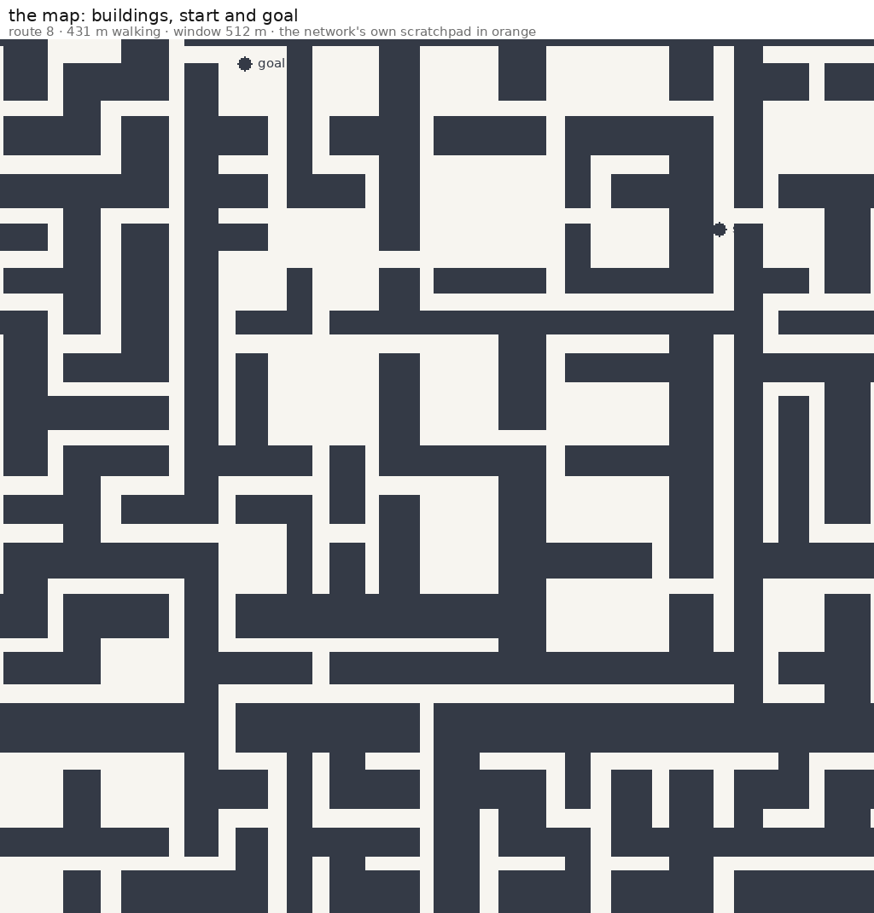
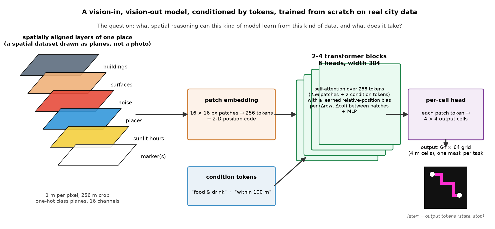
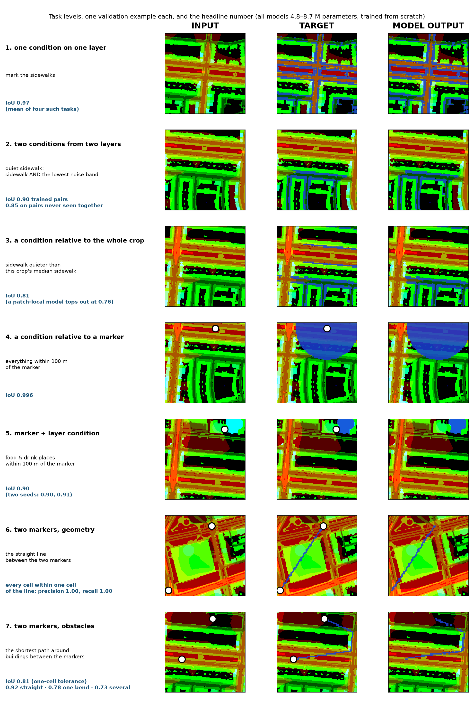
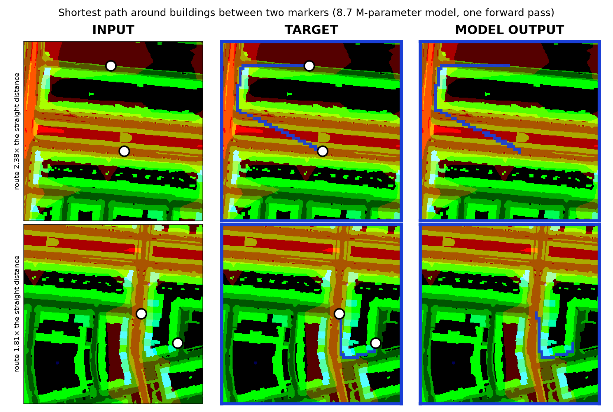
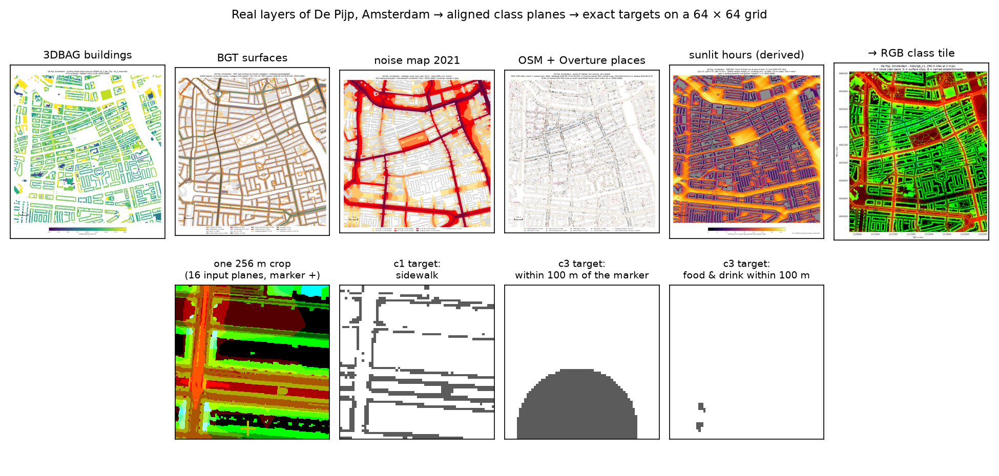

# Spatial reasoning from scratch on real city data



*A 4-block, 8.9 M-parameter transformer trained only on Amsterdam finds a 431 m walking route through a synthetic maze it has never seen, in 26 passes over its own scratchpad (orange: each frame is the network's output, fed back verbatim as its next input; leftover cells from the search stay on the drawing). Run `c5_r5_wave_nat3_tok01_from_ownp50_L4_16k_g256_b64_zc512`, 512 m window.*

This repository is a study of one question: **what spatial reasoning can a small vision transformer learn when the input is not a photo but a set of spatially aligned data layers, and what does it take?**

The input is a 256 m square of Amsterdam drawn as planes: buildings from the 3D building register, surface types from the national base map, the road-noise map, places from OpenStreetMap and Overture, hours of sunshine computed from building heights. Every plane shows a different property of the same ground at the same pixel, one metre per pixel. On top of these the task can place one or two **markers**, points the question refers to ("within 100 m of *here*"). The question itself arrives as two **condition tokens** in front of the image tokens ("food & drink", "within 100 m"). The model answers with a **mask** on a grid of 4 m (later 2 m) cells. Everything in between is a plain transformer of 2 to 4 blocks, 5 to 9 million parameters, trained from scratch on one district.

Every task has an exact answer computed from the data, so every number below can be checked. The tasks form a ladder from "mark the sidewalks" to "draw the shortest path around the buildings from here to there". The one-shot part of the ladder ends where a single forward pass stops being enough; the last rung replaces the single pass by a loop, in which the same kind of network runs a whole path search on its own scratchpad (*The search*, below). A fine-tuned vision-language model, Qwen3-VL-2B with LoRA, is the outside reference on the same routes (*The Qwen track*).



## The tasks and the results



Seven one-shot task levels, one validation example each, and the headline number. Full numbers, seeds and run ids are in the two reports under `docs/reports/` (`M1_…`, `C4_…`); the run ledger `runs/experiments.json` holds every configuration. The search rung and the Qwen track have their own reports, `docs/reports/C5_WAVE_SEARCH_2026-10-03.md` and `docs/reports/TRACK_A_QWEN_VANILLA_AND_SFT_2026-10-08.md`, and their own sections below.



*The hardest one-shot task: four validation examples. Left: the map layers with two markers. Middle: the exact shortest path around buildings, computed geometrically. Right: what the 8.7 M-parameter model draws in one forward pass.*

What this is **not**: no reinforcement learning, one city. The vision-language model appears only as a fine-tuned baseline on the same task, not as the system under study. The one-shot path-finding numbers use a one-cell tolerance on one-cell-wide targets and say so; the search is scored by a route rule stated in full below. The *Limitations* section lists what is not claimed.

## The search

**What the network does.** One network, one interface: the map planes + a **scratchpad** (one more input plane) + a **state token** go in; the **whole next scratchpad** + the next state token come out. Output *i* is input *i + 1*, verbatim. Once the network runs, nothing is computed outside it: no route handed over, no tally of past outputs, no rescaling, no code that picks the next step. The network's own token decides the phase (SEARCH, BACK, DRAW) and when to stop (DONE). The algorithm it is taught is a breadth-first wave from the start, then a walk back from the goal along the wave, then one pass that keeps only the path (report §1).

**The data rule.** Every route gets one wave: a Dijkstra search over the free 1 m pixels from the start, with a price per metre that rises from 1 in the open to 5 at a wall, run on the district with a 100 m margin and clipped to the window. Front *j* is the ring of 2 m cells where the walking distance crosses *j* × 40 m, and the way back is the wave's parent links from the goal, drawn three cells wide. A route yields one training pair per pass (a forward pass adds the next front, a backward pass extends the path one front inward and erases that front, the draw pass keeps only the path), and the loader draws one pass at random, forward : backward : draw = 4 : 4 : 1 (report §2). The wave has no choices to make, which is why it is learnable where two earlier search targets, rays to building corners and "key trajectories" along streets, were not (`docs/memo/WAVE_SEARCH_2026-10-01.md`).

**Results.** *Solved* means: on the final scratchpad there is a chain of lit cells from start to goal that crosses no cell that is entirely building and is at most 1.10 × the teacher's walking length. Extra lit cells elsewhere are not penalised. Free-running, from the start disc, nothing from the teacher after that; 500 routes per row; 4 blocks, 8.9 M parameters; network `c5_r5_wave_nat3_tok01_ownp50_from48k_L4_16k_g128_store100k` (48k steps, then one round of natural noise, see below; report §4.6 and §4.9).

| routes (256 m window) | solved | 2–3 fronts (40–120 m) | 4–5 fronts (120–200 m) | 6+ fronts (200 m and more) |
|---|---:|---:|---:|---:|
| De Pijp val | **78 %** | 96 % | 89 % | 63 % |
| De Pijp test | **73 %** | 97 % | 85 % | 49 % |
| Zuid + Centrum val, a district never seen in training | **60 %** | 88 % | 61 % | 40 % |
| house maze, never trained on mazes | **51 %** | 84 % | 51 % | 6 % |

Before the round of natural noise the same network (`c5_r5_wave_nat3_tok01_banneal5_noisep1_L4_48k_g128_store100k`) solved 64 / 61 / 44 % of the first three rows (report §4.3). The house maze is a synthetic district of corridors 8–12 m wide between walls 14–30 m thick, in three styles (perfect maze, braided maze with loops, rooms and doors; `spatial_data/maze_world.py`).

Animations, one frame per pass (all in `docs/figures/`): [De Pijp, 424 m](docs/figures/wave_search_256m_de_pijp_route333_424m.gif), [never-seen district, 295 m](docs/figures/wave_search_256m_unseen_district_route342_295m.gif), [house maze, 193 m](docs/figures/wave_search_256m_house_maze_route271_193m.gif), [512 m window, 486 m](docs/figures/wave_search_512m_map_route176_486m.gif), [512 m window, 528 m](docs/figures/wave_search_512m_map_route054_528m.gif). These are chosen best cases; for an honest pair, a [solved](docs/figures/wave_search_256m_de_pijp_route091_solved.gif) and a [failed](docs/figures/wave_search_256m_de_pijp_route363_failed.gif) route of the first search network, with the failure explained in report §6.

**The loop needs depth.** The same recipe at 2 blocks (5.3 M parameters) is a few points behind the 4-block network teacher-forced (IoU within 4 m on the forward passes 0.87 against 0.92) and solves **4 %** of the first 200 De Pijp val routes free-running, against 75 % for 4 blocks on the same routes. Its backward drawing collapses once it reads its own output (`c5_r5_wave_nat3_tok01_banneal5_noisep1_L2_48k_g128_store100k`; report §4.1–4.3). Teacher-forced scores did not predict rollout success.

**One output token can ruin a dense output.** Mixing the backward passes into one network first failed: the new piece of path came out as a blob ([figure](docs/figures/wave_hop_blob_token_weight_1.png)). Eleven hypotheses were tested one at a time against a reference known to work (ties in the teacher's way back, pad noise, Dice, the learning-rate schedule, the store, the loader, ...). The cause was the token loss: alone, a pass type has a constant output token and its loss vanishes; in a mix the token is a real decision, and one cross-entropy per sample at weight 1.0 outweighed a grid loss averaged over 16,384 cells. At weight **0.1** false cells on the backward hop fell from 180 to 98 per sample, and the token itself was learnt better (0.998 / 1.00 against 0.96 / 0.96 accuracy) (`docs/memo/WAVE_MIX_TOKEN_LOSS_2026-10-02.md`; report §5.5). Two suggestions on the way were wrong and are kept in the report: group-normalised change weights, and removing the lit-cell weight, which breaks the loop because the network then under-paints.

**Natural noise: training on its own drawings.** In the loop the network reads its own previous drawing, mistakes included, while training had shown it the teacher's. One round fixes much of that: run the network under the teacher's schedule over all 100k training routes, store its drawing after every pass (1.16 M passes, 10.5 min), and continue training for 16k steps with half of the input drawings replaced by these stored ones, the target staying the teacher's clean next drawing. That added 14 points on De Pijp val (64 → 78 %), 12 on test (61 → 73 %), 15 on the never-seen district (44 → 60 %); the teacher-forced numbers did not move. Mixing the stored drawings into a from-scratch run instead was 3–5 points worse at three times the compute. A second round (`c5_r5_wave_nat3_tok01_ownp50_r2_L4_16k_g128_store100k`: 80 / 71 / 60 %) did not add a clear further gain (report §4.6).

**Larger windows and the mazes.** At 512 m the routes reach 1.1 km walking and up to 28 fronts. The 256 m network continued at 512 m on the Zuid + Centrum routes, plus one round of natural noise at that size, solves **42 %** of 500 Zuid + Centrum 512 m val routes: 91 / 71 / 53 / 30 / 4 % for 2–3 / 4–5 / 6–8 / 9–12 / 13+ fronts (`c5_r5_wave_nat3_tok01_ownp50_r1_L4_16k_g256_b64_zc512`; report §4.7). On the 512 m house maze it solves 40 % before that round and 39 % after (`c5_r5_wave_nat3_tok01_from_ownp50_L4_16k_g256_b64_zc512`, the hero network). A thin-wall maze (walls 2–6 m) fails zero-shot: 4 % solved, the first pass already draws a round ring straight through the walls (48k network; report §7). The network learnt to run the wave around building-sized obstacles, the kind it was trained on, not around obstacles of any shape.

**The cleanup pass.** The draw pass given a real job: input the network's own final drawing, target the shortest chain through its own lit cells (or the teacher's path when that chain is not a success), with a lower lit-cell weight on that pass. At draw weight 3 the network keeps 70 % of De Pijp val solved and triples the share of clean final drawings (at most 1.25 × the cells of the thin chain) from 14 % to 42 %: a trade of 8 points of success for cleanliness, not a free improvement (`c5_r5_wave_nat3_tok01_cleanup100_dw3_ownp50_r2_L4_16k_g128_store100k`; report §4.8). At 512 m: [[512 NUMBERS: cleanup / one-shot 512]].

**Timing.** On the RTX 3060 in bf16, one pass takes 2.4 ms at batch 1; a whole free-running route, one at a time with the loop around it, 57 ms on average (10.3 passes, grid and token as two forwards per pass) (48k network; report §4.5).

## One-shot vs search vs a vision-language model

Three systems on the same De Pijp validation routes: the one-shot network (the same 4-block transformer without scratchpad, trained to draw the path in one pass for 64k steps, the search's total training budget: `c5_os_bld_det_L4_64k_g128_store100k`), the search, and Qwen3-VL-2B fine-tuned with LoRA on 19.3k routes. They were first scored by different rules (cells on a scratchpad for the two small networks, a polyline for Qwen); the table puts everyone under one rule, the polyline rule: start and end within 6 m of the markers, no building crossed, length at most 1.10 × the teacher's walking length.

[[COMPARISON TABLE]]

Under the search's own cell rule the budget-matched one-shot network solves 46 % of De Pijp val against the search's 78 %, 35 % against 60 % on the never-seen district, and 18 % against 51 % on the house maze; four times the training of the earlier one-shot run (16k → 64k steps) did not move it, and the gap grows with route length everywhere (report §4.9). A single pass has no more steps to spend on a longer route.

The failures differ in kind. Qwen's remaining errors after fine-tuning are mostly chords through buildings: on 36 % of the 500 routes its polyline crosses a building, and on 11 % an endpoint is off; the zero-shot 4B model failed the same way, on about half of its routes (Track A report §2.2, §3.4). The search's failures are breaks: on the 48k networks no connecting chain crosses a building cell, and failed routes end with a gap or a detached fragment in the drawn way back (report §6).

## The Qwen track

Done (Marvin; `qwen_reference/`, `qwen_fine_tuning/`, Track A report):

- **Zero-shot**, on the first 200 De Pijp val routes rendered as a 512 × 512 map with a green start and a red goal, the model answering with a polyline in its 0–1000 grounding grid: Qwen3-VL-2B-Instruct solves **2.5 %** (it mostly misplaces the endpoints), Qwen3-VL-4B-Instruct **24.5 %** (it finds the endpoints and draws straight lines through buildings). The straight line between the markers scores 27.6 % on the full val set.
- **An own LoRA training loop** before any library: label masking on the answer span, LoRA r 16 on the attention projections of the language model with the vision tower frozen (about 0.3 % of the parameters trainable), AdamW at 2e-4 with cosine decay, effective batch 4, 3 epochs, bf16 with gradient checkpointing, checkpoints with optimizer state and resume, evaluation by generation and the polyline scorer, all on the RTX 3060.
- **Data scaling**, 500 val routes: 21.4 % at 1k training routes, 31.0 % at 5k, **49.6 %** at 19.3k (81 / 62 / 28 % by 2–3 / 4–5 / 6+ fronts). The long routes need the data most (6+ fronts: 1.2 → 7.7 → 28.3 %).

Not done: the same run through `trl`'s trainer, GRPO, vision-tower LoRA, transfer to the other district and the maze, and A1, the search itself on a VLM backbone (*Outlook*).

## What we learned

**1. A 9 M-parameter transformer finds shortest paths around obstacles in one pass, reasonably reliably.** Two markers, the building layer, and the exact Euclidean shortest path as the target. After 16k steps on 100k examples the model traces the right route in most cases: where the route is straight it is essentially perfect, where it bends once it is right four times in five, and where it has to turn several corners it is right about seven times in ten. The errors are concentrated in the many-corner routes, which is where a single forward pass runs out of steps; finding 6 is what more steps buy. Two levers moved this task and they add up: five times more training examples, and four blocks instead of two. Two things that sounded helpful did not: a dense "mark the buildings" side task, and a looser gradient clip.

**2. The spatial encoding decides whether marker tasks can be learned at all; for tasks without markers it did not matter.** Tasks that only read the layers, "mark the sidewalks", "quiet sidewalks", reached their numbers with plain absolute position codes in 2k steps. Every task that refers to a marker stalled for thousands of steps or never started. Two changes fixed that, and neither works alone: draw the marker as a small disc instead of a single pixel, so the patch projection can see it, and give attention a learned bias for the offset between patches (the Swin-style relative position bias), so "look at the patches around the marker" is cheap to express. With both, "everything within 100 m of the marker" trains in 1.5k steps instead of 6k.

**3. Transfer between tasks happens, in both directions.** Two positive cases: a model trained on pairs of conditions composes pairs it never saw together (0.85 IoU on held-out pairs versus 0.01 with the wrong description), and the hard task "food & drink within 100 m" only became reliable when trained *together* with the plain "within 100 m" task: the easy task builds the circuit that routes information from the marker, and the hard task reuses it. Alone, the hard task escaped its shortcut in about half the runs; in the mix, in 10 of 11. One negative case: training the straight line between two markers alongside the shortest path *hurt* the path task. The two tasks share the output form and the input but contradict each other on the rule (through buildings versus around them), and they compete for the same circuit.

**4. What combined tasks cost.** A single-layer task trains in 2k steps with 4.8 M parameters. A task that combines a marker with a layer condition needed a three-task mix and 16k steps, roughly five times the presentations of the hard task itself. Path finding needed 100k examples, 16k steps at batch 128, and twice the model. The growth is in data and steps more than in parameters.

**5. A good score can hide a wrong solution.** "Food & drink within 100 m" has a shortcut: mark every food & drink place and ignore the marker. It scores 0.41 IoU, and ten configurations sat exactly there, including one with twice the parameters and four times the data. The probe that told the difference compares the prediction with each single-condition mask and plots the marked share by distance from the marker: flat for the shortcut, a step at 100 m for the solution. It is cheap and runs at the first evaluation.

**6. A loop over its own output needs depth, and only a rollout shows it.** The same search recipe at 2 and 4 blocks is a few points apart teacher-forced and 4 % against 75 % free-running (report §4.1–4.3). A teacher-forced score measures one step from a perfect input; the loop compounds every small error over 10–25 passes, and the shallower network cannot repair what it reads back. Free-running evaluation from the first checkpoint on is the only test that showed it; it also showed that rollout success keeps rising long after the teacher-forced metrics plateau (18 % at 20k steps, 75 % at 48k; report §4.4).

**7. A single token can starve a dense output.** In a mix, the state token is a real decision, and one cross-entropy per sample at weight 1.0 dominated the grid loss averaged over 16,384 cells; the drawing blurred into blobs. At weight 0.1 both the drawing and the token got better (`docs/memo/WAVE_MIX_TOKEN_LOSS_2026-10-02.md`). The general point is the balance of a scalar head against a dense head sharing one trunk, and the way to find it was one ingredient at a time against a reference rerun. The fix is not isolated in the final 48k run (*Limitations*).

**8. Showing the network its own mistakes teaches it to repair them.** Replacing half of the input drawings by the network's own stored drawings, with the clean next drawing as the target, added 12–15 points free-running at no change in teacher-forced quality, most on long routes and on the never-seen district (report §4.6). Training clean first and repairing afterwards beat mixing the noise in from the start, at a third of the compute. The same idea, pushed into the draw pass as a cleanup step, trades success for clean drawings at 256 m and does not carry to 512 m (report §4.8).

## How it is built

- **Data** (`worldsnap/`): seven public layers of De Pijp, Amsterdam, downloaded with a manifest (source, licence, vintage, checksum), rasterised at 1 m, cut into 256 m crops; a derived sunshine layer from a sun-position formula and a ray-march over building heights. A second district, Zuid + Centrum, for transfer tests and 512 m windows. Nothing is cleaned; oddities are documented. Licences per layer: `DATA_LICENSES.md`.
- **Tasks** (`spatial_data/`): targets computed from the planes on the GPU; conditions as tokens; markers as a plane; shortest paths from a visibility graph over the building outlines, verified against a grid search. Held-out ground is four scattered blocks of the district no training crop touches. For the search: one wave per route (`c5_wave.py`), the teacher's pass schedule (`wave_search_schedule.py`), the stores of the network's own drawings and cleanup targets (`c5_own_pads.py`, `c5_cleanup.py`), the synthetic maze district (`maze_world.py`), and the export of routes as map images and polylines for the Qwen track (`track_a_export.py`, also the polyline scorer).
- **Model** (`plain_gpt_module/`): 16 px patches, 2-D sine-cosine positions, 2 or 4 blocks of 6 heads at width 384, an optional learned relative position bias per block, two condition tokens, a per-cell head; for the search a scratchpad input plane, a readout token with a state-token head, and the change-weighted grid loss with its β schedule (`wave_pad_ce.py`, `wave_beta_schedule.py`). Written from scratch; `LOCAL_MODEL_GUIDE.md` is the document it was built from.
- **Training and diagnostics** (`harness/`): a run ledger, and a diagnostics suite that records per evaluation the attention entropy and attention-to-marker of every head, per-group update ratios and gradient norms, and prediction strips. For the search: free-running and scheduled rollout evaluation (`diagnostics/wave_rollout_eval.py`), animations (`wave_rollout_gif.py`), timing (`wave_rollout_timing.py`), the ties diagnostic of the teacher's way back (`wave_back_ties.py`), and the one-shot model scored by the search's rule (`oneshot_route_eval.py`). Most of the findings above were read off those, not off the loss.
- **Qwen track** (`qwen_reference/`, `qwen_fine_tuning/`, `models/download_qwen.py`): loading, prompts and coordinate conversion, zero-shot evaluation, the LoRA training loop and adapter evaluation. Requirements in `requirements-track-a.txt`.



## Running it

```bash
pip install -r requirements.txt
python -m pytest tests -q          # data-dependent tests skip without the sample bundle
```

`REPRODUCE.md` lists the pipeline commands, layers → crops → path store → one run per task level, then the wave data, the search runs, the natural-noise store, the rollout evaluation and the Qwen track, with wall times on an RTX 3060, and how to load a released checkpoint (the GitHub releases hold one model per one-shot task level, and the search networks, the matched one-shot network and the Qwen LoRA adapter).

## Limitations

- One city. The search was trained on one district (later two, at 512 m) and tested on a second district and on synthetic mazes; no other city was tried.
- **The search's headline depends on the route mix and the round.** The 48k network solves 75 % of the first 200 De Pijp val routes and 64 % of all 500, because the 500 hold more long routes; after one round of natural noise 78 % (val) and 73 % (test). The honest single numbers for the training district are 73–78 %.
- **Single seed** for every search configuration (seed 4). The seed spread of the rollout success rate is not measured; the binomial standard error at 500 routes is about 2 points, per length band 2–4.
- **The success rule scores a set of cells**: a chain of lit cells within 1.10 × the teacher's clearance-priced walking length; extra lit cells are not penalised, which is why the cleanup pass was needed to measure clean drawings at all. The comparison table rescores every system under one polyline rule.
- **Long rollouts are sensitive to numerics.** The same checkpoint on the same 200 routes disagrees on 4 routes between a CPU and a GPU run, all of them with 6–9 fronts (177 against 179 solved; `wave_rollout_eval_cleanliness_cpu.json` against `wave_rollout_eval_val500.json` of the best 256 m network). One cell of difference early is fed back for 15–25 passes. All reported numbers are from GPU runs in bf16.
- **The token-loss fix is not isolated** in the final run: the 48k 4-block recipe was not run at token weight 1.0.
- **The search is taught, not discovered.** The network executes a breadth-first wave given by a teacher, it paints much of the window on long routes, and it is neither faster nor better than classical path finding, which solves these maps exactly. Thin-wall mazes fail zero-shot.
- **No vision-language model runs the scratchpad yet**: Qwen was fine-tuned to answer in one shot; the search on a VLM backbone (A1) is planned, not built. No reinforcement learning anywhere.
- The one-shot path-finding numbers use a one-cell tolerance on one-cell-wide targets; the plain IoU is reported next to them. Most one-shot path-finding configurations are single-seed; the reference specification has two seeds 0.013 apart, and no difference below 0.02 is claimed. Courtyards count as free ground in the path tasks, by decision.

## Outlook

The many-corner routes were the argument for a model that runs a search over several passes with its own previous output as an extra input and a learned stop token; that is now built (*The search*). It differs from the first design in `docs/memo/ITERATIVE_SEARCH_2026-09-25.md` in what it draws, fronts one cell wide instead of distance values, and in that the state token, not a fixed pass count, decides the phase; the memo stays as background, the working plan was `docs/plans/C5_PLAN.md`.

Next is **A1: the same dense scratchpad interface on a pretrained vision-language backbone** (Qwen3-VL-2B or Qwen3.5-0.8B): map + scratchpad in, the whole next scratchpad + state token out, output *i* = input *i + 1*, with a dense head on the backbone's patch tokens and the state token from a small head (`docs/memo/TRACK_A_BACKBONES_2026-10-01.md`). It asks whether a pretrained backbone learns the loop with less data, or transfers it better to thin walls and new cities, than the from-scratch network. A further idea, not started: let the language model stream a short commentary per pass alongside the scratchpad, so the search can be followed in words while it runs.

## Related work, in one paragraph

Vision-language map benchmarks (MapEval, MapQA, RewardMap) test frontier models on map images; this project is their controlled counterpart, aligned layers with exact targets and a model small enough to open. The relative position bias is Swin's (Liu et al. 2021); point prompts as tokens (Segment Anything, Kirillov et al. 2023) are the road not taken. The shortcut is shortcut learning in the sense of Geirhos et al. 2020; the heads sinking onto the constant condition tokens are the attention-sink phenomenon (Xiao et al. 2023) in a tiny ViT; the mix findings are small data points for the task-grouping literature (Standley et al. 2020). The search builds on Deep Thinking networks (Schwarzschild et al. 2021; Bansal et al. 2022) and neural algorithmic reasoning (Veličković and Blundell 2021); training on the network's own drawings is the scheduled-sampling / DAgger idea (Bengio et al. 2015; Ross et al. 2011) applied to a scratchpad. The Qwen track fine-tunes Qwen3-VL (Qwen team, 2025) with LoRA (Hu et al. 2021).

## Authorship and licence

Marvin Uhlmann, with Claude (Anthropic) and Cursor Composer as assistants; the split is in `AUTHORSHIP.md`. Code is MIT-licensed (`LICENSE`); data sources and their licences are in `DATA_LICENSES.md`. The Qwen3-VL weights are not part of the repository (`models/download_qwen.py` fetches them) and carry their own licence.
