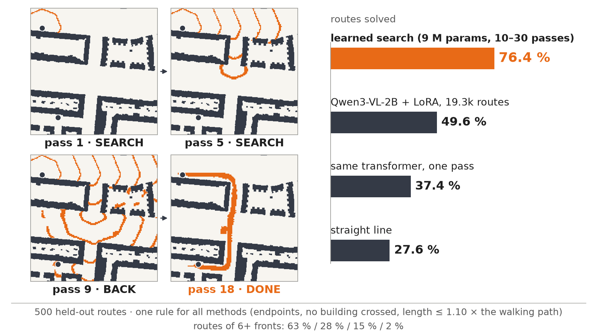

# Spatial reasoning from scratch on real city data

## A small transformer runs a path search on its own scratchpad

**Marvin Uhlmann**

*An independent research artifact. Written with AI assistance (Claude, Anthropic; Cursor Composer); the division of work is documented in [`AUTHORSHIP.md`](AUTHORSHIP.md).*

An 8.9 M-parameter transformer, trained from scratch on aligned city layers, learns to run a multi-pass path search on its own visual scratchpad. On 500 held-out Amsterdam routes it solves **76.4 %** under a strict polyline rule, compared with **49.6 %** for a fine-tuned Qwen3-VL-2B and **37.4 %** for the same 4-block trunk trained to answer in one pass.



*The headline result. Left: four passes of the learned search on a held-out route. Right: solved share on the same 500 De Pijp validation routes under one polyline rule: learned search 76.4 %, Qwen3-VL-2B + LoRA 49.6 %, one-shot transformer 37.4 %, straight line 27.6 %.*


*The network searches through a synthetic 512 m house maze it never saw during training. Its own output is fed back verbatim on every pass; a learned state token chooses whether to search, trace back, draw, or stop.*

<table>
<tr>
<td align="center"><strong>76.4 %</strong><br>learned search</td>
<td align="center"><strong>49.6 %</strong><br>Qwen3-VL-2B + LoRA</td>
<td align="center"><strong>37.4 %</strong><br>one-shot transformer</td>
<td align="center"><strong>63 %</strong><br>search on the longest routes</td>
</tr>
</table>

The learned search leads at every route length. Under the cell rule used for transfer evaluation, it also solves **60 %** in an Amsterdam district never seen in training and **51 %** in a synthetic house maze (single seed); the complete transfer breakdown and all qualifiers are in the report.

**Read the [full research report](PAPER.md)** · **See [how the released results were reproduced](REPRODUCE.md#8-reproducing-the-papers-tables-from-the-release)** · **Inspect [authorship](AUTHORSHIP.md) and [data licences](DATA_LICENSES.md)**

---

## Result at a glance

Every route method below is evaluated on the same 500 held-out routes using the same rule: the prediction must begin and end within 6 m of the markers, cross no building, and be no more than 1.10 times the reference walking length ([report, Section 7](PAPER.md#7-under-one-rule-the-search-beats-both-the-one-shot-network-and-the-fine-tuned-vlm-and-they-fail-differently)).

| method | parameters | computation | solved | 6+ search fronts |
|---|---:|---|---:|---:|
| straight line | — | geometry floor | 27.6 % | 2 % |
| one-shot grid transformer | 8.9 M | one forward pass | 37.4 % | 15 % |
| Qwen3-VL-2B + LoRA on 19.3k routes | 2B | one generated polyline | 49.6 % | 28 % |
| **learned wave search** | **8.9 M** | **repeated passes over its own scratchpad, until its state token says stop** | **76.4 %** | **63 %** |

The comparison is controlled at the routes and scoring rule, not at the input interface: Qwen sees a rendered map image and emits coordinates; the small transformers receive aligned one-hot layers and marker planes and draw on a cell grid. The distinction is central to the claim.


*Three held-out routes. The fine-tuned VLM usually connects the endpoints but often cuts through buildings; the learned search respects the geometry but can leave a gap in its trace-back drawing.*

## What was built

The project starts from public map layers of Amsterdam at one metre per pixel: buildings, surfaces, road noise, places, and derived sunlit hours. Tasks add marker planes and two condition tokens; every target is computed exactly from the underlying spatial data ([report, Section 3](PAPER.md#3-every-task-has-an-exact-answer-computed-from-public-map-layers)).


*The data. Top: the public layers of De Pijp, Amsterdam (3DBAG buildings, BGT surfaces, the 2021 noise map, OpenStreetMap and Overture places, derived sunlit hours) and the class tile they are combined into. Bottom: one 256 m crop as the model sees it, with a marker, and three of the exact targets computed from it: sidewalk, within 100 m of the marker, food & drink within 100 m.*

A 5–9 M-parameter transformer is trained from scratch through a seven-level ladder:

1. read one layer;
2. combine two layers, including unseen condition pairs;
3. compare a cell with a statistic of its crop;
4. reason relative to a marker;
5. combine marker-relative geometry with a map class;
6. draw the segment between two markers;
7. draw the shortest route around buildings.

The one-shot model reaches the final level but degrades as routes acquire more corners ([report, Section 4](PAPER.md#4-the-layer-model-reads-and-combines-layers-in-one-forward-pass-and-its-limit-is-the-route-with-many-corners)). The second part of the project gives the same kind of network a scratchpad plane and a state token. It is taught a breadth-first wave, a trace back from the goal, and a final draw phase. At inference time no external planner intervenes between passes ([report, Section 5](PAPER.md#5-a-network-runs-a-path-search-on-its-own-scratchpad)).


## Four findings

### 1. The spatial encoding decides whether learning starts

Marker-relative tasks repeatedly stalled until two changes were present together: markers were rendered as detectable discs rather than single pixels, and attention received a learned two-dimensional relative-position bias. With both, the 100 m task trained in roughly 1.5k steps instead of about 6k.

The diagnostics show two separate failures: the patch projection must preserve the marker, and attention must then route information relative to it cheaply.

### 2. A plausible score can hide the wrong rule

"Food and drink within 100 m" admits a shortcut: mark every food-and-drink cell and ignore the marker. Ten configurations converged to that solution at 0.41 IoU. A probe of marked share by distance exposed the shortcut at the first evaluation: the shortcut is flat with distance, while the intended solution has a step at 100 m.

Training the hard task together with the bare radius task made the intended circuit reliable: it escaped the shortcut in 10 of 11 mixed-task runs, compared with about half of single-task runs.

### 3. A learned loop needs depth and exposure to its own errors

Teacher-forced scores made the two-block and four-block search models look close. Free-running, the two-block model solved 4 % of the first 200 De Pijp validation routes, against 75 % for the four-block model on the same routes; on all 500 routes the four-block model solves 64 %, and 78 % after the natural-noise round below (cell rule). The evaluation that matched deployment, the complete rollout, was the one that revealed the difference.

Continuing training on the network's own imperfect intermediate drawings ("natural noise") added 12 to 15 points on De Pijp validation, the De Pijp test split and the never-seen district, while teacher-forced metrics did not change ([report, Section 5.3](PAPER.md#53-depth-a-balanced-token-loss-and-training-on-its-own-drawings-made-the-loop-work)).

### 4. The small search and the VLM fail differently

After LoRA fine-tuning, Qwen3-VL-2B always produces a parseable line, misses an endpoint on 11 % of routes and crosses a building on 36 %. The learned search cannot miss an endpoint under the conversion from drawing to polyline (the chain starts at the markers) and fails by gaps in the drawing: a break or a detached fragment in the trace back ([report, Section 7.3](PAPER.md#73-the-vision-language-model-fails-on-geometry-the-search-on-continuity)).

The complementary failures matter more than the leaderboard. They raise a design question: when should geometry be a latent language-model output, and when should it live in a spatial scratchpad with an explicit recurrent interface?

## Scope of the result

The headline is intentionally narrow ([report, Section 8.6](PAPER.md#86-the-results-hold-for-one-city-single-seeds-and-a-taught-algorithm)):

- one city, with transfer from one Amsterdam district to another and to synthetic mazes;
- a taught breadth-first wave, not an algorithm discovered from reward;
- single seeds for the search configurations;
- different model interfaces, despite shared routes and scoring;
- one-cell tolerance for the thin one-shot targets, always reported with plain IoU;
- no reinforcement learning;
- no vision-language model running the scratchpad loop yet;
- no claim that the learned search is faster or more accurate than classical path finding.

The full report gives the result by route length, the negative 512 m cleanup result, the hardware sensitivity of long rollouts, the seed limitations, and the run identifiers behind the numbers.

## Evidence and artifacts

The repository is a research record:

- [`PAPER.md`](PAPER.md): complete methods, results, comparisons, limitations, and references;
- [`docs/CLAIMS_AUDIT.md`](docs/CLAIMS_AUDIT.md): every number traced to its evaluation file;
- [`docs/reports/`](docs/reports/): detailed reports behind the marker, path, search, and Qwen results;
- [`runs/experiments.json`](runs/experiments.json): the run ledger and configurations;
- [`REPRODUCE.md`](REPRODUCE.md): data construction, training commands, checkpoint loading, and clean-clone replay;
- [`docs/RELATED_WORK.md`](docs/RELATED_WORK.md): the extended literature review;
- [`AUTHORSHIP.md`](AUTHORSHIP.md): component-level authorship and AI assistance;
- [`DATA_LICENSES.md`](DATA_LICENSES.md): provenance and licensing of every source layer.

The `v0.2` release contains the search checkpoints, the matched one-shot checkpoint, the Qwen LoRA adapter, the evaluation bundle, and the per-route predictions. The release replay described in `REPRODUCE.md` reconstructs the headline tables from a fresh clone and the released assets alone.

## If you want to run it

This is not presented as a pip-installable library. The shortest useful entry points are:

- **Inspect the evidence:** read the report and run ledger without downloading data.
- **Recompute the published tables:** follow [`REPRODUCE.md` section 8](REPRODUCE.md#8-reproducing-the-papers-tables-from-the-release) with the release assets.
- **Rebuild the complete experiment:** follow the earlier sections of `REPRODUCE.md` to download and rasterize the public map layers, generate targets, and retrain the models.

```bash
pip install -r requirements.txt && python -m pytest tests -q   # data-dependent tests skip without their data
```

Reconstructing the complete data pipeline downloads the raw public layers ([`REPRODUCE.md` section 2](REPRODUCE.md#2-data-rebuild-the-district-from-public-sources)); replaying the released evaluations does not.

## Authorship and licence

Marvin Uhlmann directed the research, designed the tasks and experiments, wrote the model, the loss and the training loop and the Qwen track, and ran every experiment. Claude (Anthropic) wrote the data pipeline, the task generators and loaders, the evaluations and diagnostics, and the reports and drafts, under Marvin's specifications and review, with Opus and Sonnet sub-agents for parts of the building. Cursor Composer assisted with the Qwen code. The split is recorded per component in [`AUTHORSHIP.md`](AUTHORSHIP.md).

Code and released weights are MIT-licensed. Source data retain their own licences; the Amsterdam label stacks in the evaluation bundle are released under ODbL 1.0 with OpenStreetMap attribution. See [`DATA_LICENSES.md`](DATA_LICENSES.md).
