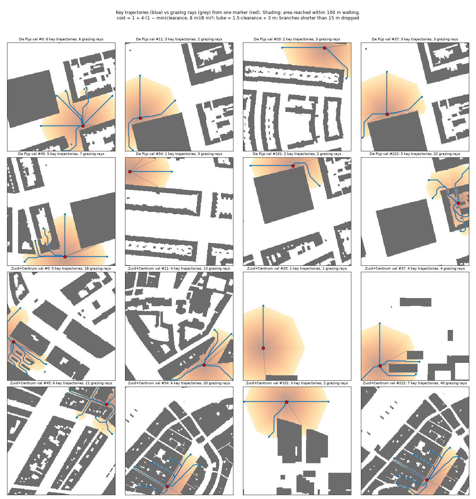
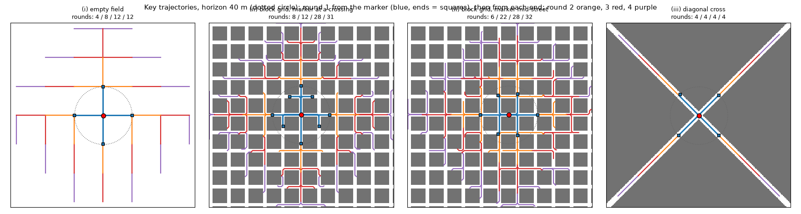
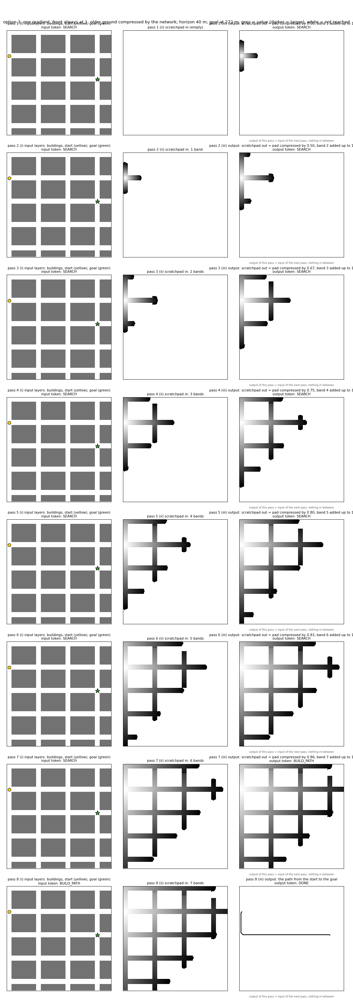
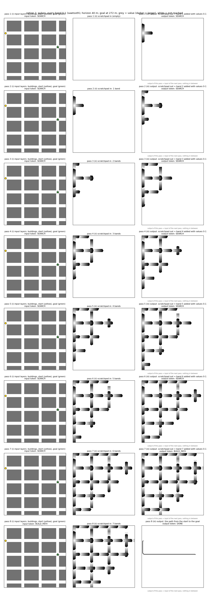

# Memo: from rays to the wave search — what we learnt and the task we will train (30 Sep – 1 Oct 2026)

Conversation Marvin / Claude, 30 Sep and 1 Oct 2026. This memo records the reasoning, the dead ends, the three
options Marvin put on the table and how we developed them into one task package. Figures and the scripts that
made them are in `docs/memo/wave_search_2026-10-01/`. It supersedes the rung-1 ("cast rays") part of
`docs/plans/C5_PLAN.md`; the plan is updated separately.

## 1. Where we came from

**Rays (C5 rung 1, first definition).** Straight segments from each marker to every visible building corner
within 80 m. Result (R1, R1b): tolerant IoU 0.50–0.52 against a pass mark of 0.85, at 64×64 and 128×128 alike.
Marvin's verdict: not a hard task but a badly defined one. About 16 rays per marker (6 after keeping only the
rays that graze a corner) merge into a blob at 4 m cells, and "point at the corners" is not how a person reads a
map; a person follows streets.

**Key trajectories (second definition, 30 Sep).** Marvin's idea: run one bounded wave from the marker, keep
the "key trajectories" — the ones that got farthest, merged where they run next to each other in one street,
kept apart on different streets, pulled away from buildings. Claude's proposal for that was the TEASAR rule
(Sato et al. 2000, centre lines of vessels), adapted to a map:

1. clearance = distance of every free pixel to the nearest building (buildings are the only obstacle);
2. price per metre walked = 1 + 4·(1 − min(clearance, 8 m)/8 m)², 5 at a wall, 1 from 8 m away;
3. one cheapest-path wave from the marker on the 8-neighbour 1 m grid (tree of parent links);
4. walking length = real metres along the tree, kept to the horizon;
5. repeat until everything reached is covered: farthest uncovered point, its path back, a band around the path
   of radius 1.5·clearance + 3 m, keep the path if its own new part is ≥ 15 % of the horizon.

Refinements Marvin asked for after the galleries: one marker only (the second is not needed for this rung);
four directions on an empty field (band capped at 0.75 × horizon, and among equally far points the one farthest
from what is drawn wins); rounds 2–4 from each end with the earlier coverage kept ("branching out"); 40 m horizon
(100 m unnecessarily ambitious, 20 m degenerate); three made-up test windows for every builder (empty field,
block grid, diagonal cross); and the wave must run on the district map with a margin around the window so that a
marker near the edge explores towards and beyond the edge (route 74 in the L4 run had learnt "never explore
down" only because the window ended 15 m below the marker).

Builder: `spatial_data/c5_trajectories.py`; cases: `spatial_data/c5_traj_cases.py`.




**Results with the trajectories (100 m, De Pijp, 8k–16k steps, 2–4 blocks):** tolerant IoU 0.52–0.55, precision
0.85–0.90, recall 0.67–0.70. The model draws the main street trajectories in the right place and misses side
branches and turns. More steps did not help: 8k more steps took the train loss from 0.33 to 0.28 while the val
loss stayed at 0.47. Two causes were identified:

- **The model learns the training ground, not the rule.** 100k samples are windows of one district on a 1 m grid,
  about 69k distinct positions that overlap almost completely; 20 passes over identical samples. R0 also dropped
  from 0.80 (De Pijp val) to 0.64 on the new map's held-out ground, and to 0.44 on routes with large detours. The
  ground check (`/tmp/c5smokebin/eval_ground.py`: training ground vs val ground vs new map) is prepared.
- **The target has arbitrary choices.** Which of two equally far points is picked (north first by pixel order),
  which side street becomes a branch — a pixel loss punishes valid alternatives.

## 2. Failed suggestions (Claude's), and why they were wrong

1. **A list of loss operators** (clDice for thin connected lines, mass per angular sector for "all directions",
   mass per ring for "as far as the horizon", a building penalty, distance-weighted misses). Correct as operators,
   but they patch a target that is arbitrary; the pooled terms can be gamed by smears; and they follow the
   checklist instead of removing the cause.
2. **"Learn the wave, not the picking", with bookkeeping outside the network:** the model predicts a distance
   field per pass, code selects the end to expand (the A\* rule: distance walked + straight line to the goal),
   code assembles the route by descending the field, the model only redraws it taut. Marvin, rightly: then the
   transformer is a local operator and the code does the thinking. The point is a network that carries out the
   search itself, with this task later being one of many it can use in an integrated, flexible way.
3. **Accumulating or rescaling the scratchpad outside the network** (adding the pass offset, keeping the union
   of reached cells). Same objection: once the network runs, nothing is processed outside it. The output of a
   pass is the input of the next pass, verbatim.

The rule that came out of this: **once the network is running, no processing happens outside it.** No shortest
route is computed and handed over, no tally of past outputs is kept, no rescaling. The output of pass *i* is the
scratchpad and the state token of pass *i+1*. If scaling is necessary, the network does it.

## 3. The three options and what they became

Marvin's three options (1 Oct):

1. **Centre lines** (the key trajectories above): the wave fronts as street centre lines, with the way back
   implicit in the line. Compact and human-like; limitations as in §1.
2. **Pulses:** every pass adds one new wave front, a band one horizon wide, with a rising gradient inside it
   (so the direction between fronts is clear). The scratchpad is the stack of bands; nothing on it is changed.
   The route back hops from front to front, always to the closest, until home.
3. **One gradient:** a single rising surface from the start, extended by one band per pass; the route back is
   plain descent. Marvin's correction to Claude's first drawing of it: the network cannot start with "a little
   bit of gradient" because it does not know how far it will have to go; the front is always at full value, and
   the network compresses the older ground itself between input and output.

Two additions that apply to both:

- **The output is the whole scratchpad**, not the newly added part: the earlier bands reproduced (copied, or in
  option 3 compressed) plus the new band. "Copy what is on the scratchpad" (Marvin's rung-0 idea from 29 Sep)
  is therefore part of every pass.
- **A state token in and out on every pass:** SEARCH while the wave grows; on the pass whose output first covers
  the goal the output token switches to BUILD_PATH; the next pass, with BUILD_PATH in, outputs the path from
  the start to the goal and the token DONE. The tighten rung follows as before.




Rows: passes 1–8 (7 wave passes, 1 path pass). Columns: (i) input layers and input token; (ii) scratchpad in;
(iii) output = scratchpad out and output token. Column (iii) of a row is column (ii) of the next row.

What the pictures make visible:

- The wave is breadth-first: by pass 7 most of the window is painted although the goal lies east. This is the
  network doing the search, without goal-directedness. A goal-aware front (extend only what can still beat the
  best known route) can come later as a different teacher; the outputs stay the same kind of band.
- Option 3 makes the network re-value old ground every pass (0.5 becomes 0.43 in the next pass with 10 m
  classes); option 2 makes old ground a pure copy but puts seams into the pad, which the path pass must hop.
- The path pass reads the whole pad in one go; it can also be done a band per pass (the same horizon in reverse).

## 4. How the patterns and the task package are generated

Everything derives from **one true wave per sample**, computed once at build time, deterministic, no picks, no
ties. The clearance-priced wave is the same as in the trajectory builder (`spatial_data/c5_trajectories.py`,
class `_Field`); the walking length is real metres along the tree. With a margin of one horizon around the
window, clipped to the window afterwards (the edge rule of §1).

```python
# one wave from the start: parent links + walking metres (spatial_data/c5_trajectories.py provides _Field, _walk_length)
field = T._Field(mask)                                  # clearance, priced 8-neighbour graph over free pixels
src = field.idx[int(start[1]), int(start[0])]
D, pred = dijkstra(field.G, indices=src, return_predecessors=True)
length = T._walk_length(pred, np.isfinite(D), field.fy, field.fx, src)   # metres from the start, inf if unreached
dist = np.full((SIZE, SIZE), np.inf); dist[field.fy, field.fx] = length
band = np.where(np.isfinite(dist), np.floor(dist / R), -1).astype(int)   # band index per cell, R = horizon (40 m)
n_pass = int(length[goal_node] // R) + 1                                  # the pass whose output first covers the goal
```

The scratchpad after *k* passes (the input of pass *k+1* and the output of pass *k*):

```python
def pad(k):                       # None = empty pad (input of pass 1)
    if k == 0:
        return None
    cells = (band >= 0) & (band < k)
    if option == 2:
        return np.where(cells, (dist % R) / R, np.nan)     # pulses: 0-1 within every band (sawtooth)
    return np.where(cells, dist / (k * R), np.nan)          # one gradient: 0 at the start, 1 at the current front
```

The passes with their tokens, and the path pass (the way back = the tree's parent links from the goal, i.e.
descending the field):

```python
steps = []                                                # (token in, pad in, token out, pad out)
for k in range(n_pass):
    steps.append(("SEARCH", pad(k), "SEARCH" if k + 1 < n_pass else "BUILD_PATH", pad(k + 1)))
steps.append(("BUILD_PATH", pad(n_pass), "DONE", route))  # route = trace(pred, src, goal_node) as pixels
```

Training pairs are the rows of `steps`: a sample yields one pair per pass, the loader draws a random pass. At run
time the network runs on its own outputs and tokens; nothing else is computed.

The made-up map of the figures (`illustrate_search.block_grid`): 60 × 45 m blocks, 12 m streets, start and goal at
crossings (0, 1) and (3, 2), 272 m of walking. Scripts: `illustrate_search.py` (the earlier, rejected version with
external bookkeeping — kept as the record of the mistake), `illustrate_pulses.py` (options 2 and 3 before the
"whole scratchpad" correction), `illustrate_tokens.py` (the package as agreed). All run on a laptop with numpy,
scipy and matplotlib and the repo's `spatial_data/c5_trajectories.py`.

## 5. Insights, in short

1. A target with arbitrary choices (tie-breaks, which branch) cannot be learnt from a pixel loss; the fix is a
   target without choices, not a cleverer loss.
2. The window edge is a data rule: compute on the district with a margin, clip afterwards, or the model learns
   "don't explore towards the edge".
3. 100k windows of one district are not 100k samples; the model memorises the ground. Ground diversity (the new
   map) is the lever, not more steps.
4. The network is the whole loop: output = next input, tokens included. Every helper we are tempted to run
   between passes is a piece of reasoning we would be taking away from it.
5. A pass must be the same task every time (fixed value range, fixed classes) — option 2 by construction,
   option 3 by having the network compress; and the output includes reproducing the scratchpad.
6. The made-up test windows (empty field, block grid, diagonal cross) belong to every builder; they showed the
   north-first default and the single-spoke problem before any training run did.

## 6. Open points and next steps

- **Options 2 vs 3:** both come from the same wave; build both value maps and let the first runs decide. Claude's
  expectation: 2 is easier to learn (pure copy of old ground), 3 is easier to descend; the path pass will tell.
- **Classes at the output:** 10 bins of the pad value (0–1) plus "not reached", per cell, plus the state token
  (SEARCH, BUILD_PATH, DONE) through the token head; the path pass outputs a mask.
- **First experiment:** pass 1 alone (empty pad in, first band out) says whether 40 m of walking distance is
  learnable; then random passes with copy-and-extend; then the path pass; then rollouts on the network's own
  outputs.
- **Data:** one wave per sample on the 40k De Pijp routes (single marker, margin, clipped), the same for the new
  map once its 256 m train store exists; the trajectory files stay as a readout and for the tighten rung.
- **Goal-directed fronts** and the model deciding *when* to build the path are later teachers on the same
  interface, not changes to it.


## 7. Results 1–2 Oct (added 2 Oct): the pass works, the mix needs weighting, the loop needs robustness

Runs on the De Pijp store, first 40k routes, 128×128 output, fronts every 40 m (ids `c5_r5_wave_*`).

**Each step type alone (L2, 8k):** copying the pad is perfect (copied-cell recall 1.00), new cells are found at
0.81 / 0.65 / 0.64 / 0.64 / 0.87 (first / step / reach / back / origin) with ≈ 0 false cells, tokens 1.0. The
escape from "copy only" happens between 1k and 3k steps; L4 escapes later than L2.

**Mixes with plain CE + Dice** (fwd3 4k, mix6 16k): the copy is perfect, the extension collapses (step 0.05, reach
0.006). Cause: the new cells are a few percent of the lit cells, so "copy and add nothing" is a strong basin, and
the mixes had 1–3k steps per task, i.e. before the single-task escape point.

**Change-weighted loss** (`docs/memo/CHANGE_WEIGHTED_LOSS_2026-10-02.md`, Marvin's `plain_gpt_module/wave_pad_ce.py`):
- group-normalised weights (4 or 5 groups): new-cell recall 0.95–0.99 but 4–15 % false cells — the per-cell weight
  of an empty cell next to the hop is ~750× below that of a hop cell, so painting around the change is free.
  Claude's rule, wrong as written; the halo variant (`pad10`) halves the damage, not the cause.
- a factor (1 + β) on the changed cells: β 5 at 12k (cosine) reaches 0.84 / 0.70 / 0.62 new-cell recall at the
  corrected decision threshold with 0.4–0.7 % false cells: single-task quality for all three forward tasks in one
  network. Flat lr escapes earlier (3k) and ends 1–3 points lower than cosine; a short cooldown should close that.
  β only moves along the recall/false-cell trade-off; it does not change what the network knows.
- a weighted CE shifts the decision point: P(lit) > 1/(1+β) lights a cell. Read at the corrected threshold
  ((1+β)/(2+β)) to tell "fat" from "wrong"; but the rollout binarises at 0.5, so the deployed network must be
  calibrated there: anneal β to 0 over the run (candidate recipe), or the region rule (same weight for every cell
  in the dilated change region, lit or unlit; plain CE inside, low weight outside).

**Rollout** (`harness/diagnostics/wave_search_rollout.py`, network on its own outputs): the fwd3 β5 checkpoint draws
a fat front in pass 2 (IoU 0.25 vs teacher), the fed-back halo is off-distribution, pass 3 paints blocks. Teacher
forcing cannot show this. Fixes in order: calibration at 0.5 (anneal), perturbed pads in training (`c5_wave_pad_noise`:
thickened / dropped / added cells, target stays clean — built, off by default), own-output training later.

**Natural sampling** (built 2 Oct): `wave_fwd` draws the pass k uniformly over 0..n_goal−1 (token BACK on the last),
`wave_bwd` draws j over the fronts (DRAW on the last); spec `c5_wave_mix_natural()` with shares 4 : 4 : 1 and optional
pad noise. Training distribution = rollout distribution; the six fixed keys stay for diagnosis.


## 8. Follow-up 2 Oct (evening / night)

The backward mix failed for a reason not in §7: the token loss at weight 1.0. With weight 0.1 and 4 blocks at 48k
the whole search runs free on its own scratchpad and tokens and solves 75 % of 200 val routes. The search for the
cause, the counter tests and the numbers: `docs/memo/WAVE_MIX_TOKEN_LOSS_2026-10-02.md`; animations in
`docs/memo/wave_search_2026-10-02/`. Two statements of §7 are corrected there: the anneal alone does not calibrate
the output at 0.5 (the lit-cell weight stays on), and that weight should stay (removing it breaks the rollout).
