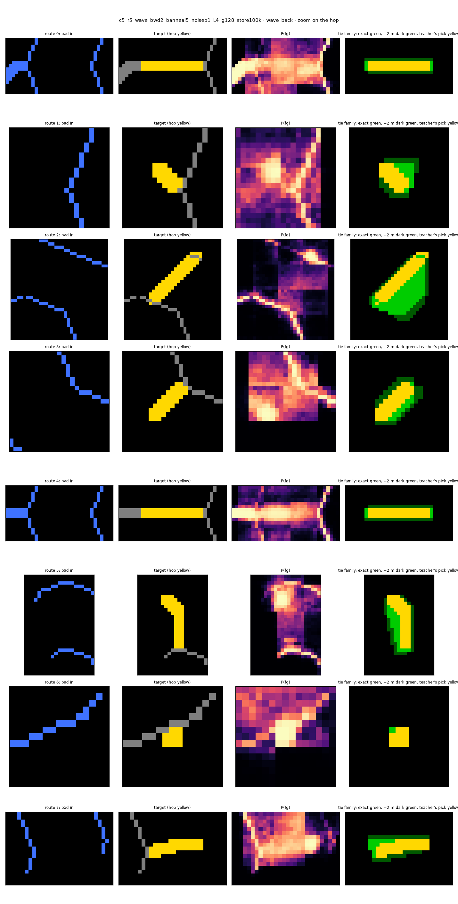
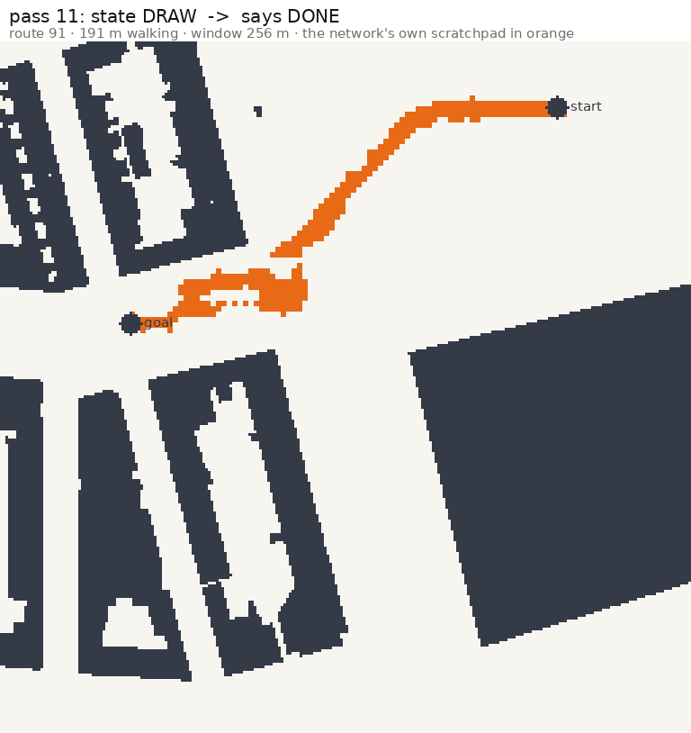
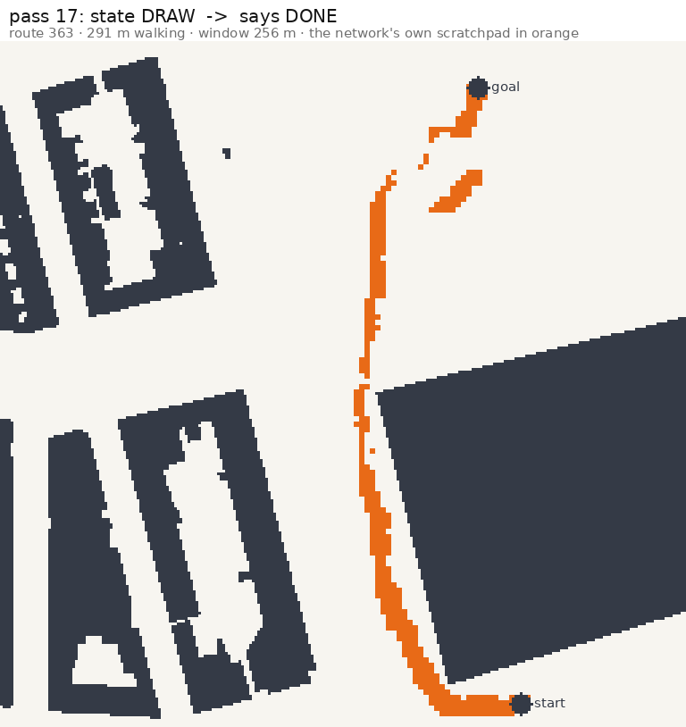

# Report: the wave search — one network runs a path search on its own scratchpad (rung C5)

Written 3 Oct 2026 by Claude from Marvin's runs of 1–2 Oct and the evaluations of 2–3 Oct. Every number is copied from a file; the source is given in square brackets after it, using the keys of the source list directly below. 

**Sources (keys used in the text).**

| key | file |
|---|---|
| [E4] | `runs/diagnostics/c5_r5_wave_nat3_tok01_banneal5_noisep1_L4_48k_g128_store100k/eval.jsonl`, last line (step 47999) |
| [E2] | `runs/diagnostics/c5_r5_wave_nat3_tok01_banneal5_noisep1_L2_48k_g128_store100k/eval.jsonl`, last line (step 47999) |
| [R4] | `runs/diagnostics/c5_r5_wave_nat3_tok01_banneal5_noisep1_L4_48k_g128_store100k/wave_rollout_eval.json` |
| [R2] | `runs/diagnostics/c5_r5_wave_nat3_tok01_banneal5_noisep1_L2_48k_g128_store100k/wave_rollout_eval.json` |
| [R4@k] | the same directory as [R4], `wave_rollout_eval_step<k>.json` (checkpoints during training) |
| [T4] | the same directory as [R4], `wave_rollout_timing.json` |
| [L] | `runs/experiments.json`, entries with the two run ids above (`summary`, `overrides`) |
| [M4] | the same directory as [R4], `meta.json` (`config.model`) |
| [W] | `data/amsterdam/de_pijp/crops/v4/c4_100k/c5_wave_val_stats.json` |
| [S] | `data/amsterdam/de_pijp/crops/v4/c4_100k/c4_routes_val_stats.json` |
| [B] | `runs/diagnostics/c5_r5_wave_bwd2_*/wave_rollout_eval_first_back.json` (four runs, named in §5.5) |
| [WS] | `docs/memo/WAVE_SEARCH_2026-10-01.md` |
| [CW] | `docs/memo/CHANGE_WEIGHTED_LOSS_2026-10-02.md` |
| [TL] | `docs/memo/WAVE_MIX_TOKEN_LOSS_2026-10-02.md` |
| [P] | `docs/plans/C5_PLAN.md` |
| [C4] | `docs/reports/C4_SEGMENT_DETOUR_2026-09-25.md` |

## 0. Glossary

- **Crop, cell, marker, condition token, block, head, relative position bias, disc marker**: as in the m1 and c4 reports. In short: a 256 m square of Amsterdam at 1 m per pixel as one-hot class planes plus a marker plane; a small vision transformer with 16-px patches; tasks selected by condition tokens in front of the image tokens; markers drawn as 3-px discs.
- **Scratchpad (pad).** Input channel 17. A binary picture the network reads; in this rung it is the network's own previous output.
- **Output grid.** 128 × 128 cells of 2 m over the 256 m window; each cell is lit or unlit.
- **Front.** The cells where the walking distance from the start crosses a multiple of 40 m: a ring one cell wide. Front *j* is at *j* × 40 m.
- **Pass.** One forward run of the network: map + pad + state token in, the whole next pad + a state token out.
- **State tokens.** In: SEARCH, BACK, DRAW (condition slot 0). Out: SEARCH, BACK, DRAW, DONE (token head).
- **Teacher.** The deterministic program that produces the target pad and token for every pass of a route (§2).
- **Teacher-forced.** Every pass gets the teacher's pad as input. **Under the teacher's schedule ("scheduled")**: the pad is the network's own output from pass 1 on, but the state token in comes from the teacher. **Free-running**: the network's own pad and its own token decide everything until it says DONE.
- **IoU within 4 m.** IoU where a cell counts as matched if the other mask has a lit cell within 4 m (two cells at 2 m). The harness calls it `iou_dilated` / `iou4m`.
- **New-cell recall / copied-cell recall.** Share of target cells that were *not* on the input pad (the work of the pass) / that *were* on it (the copy) which the network lights.
- **Solved (free-running).** Defined exactly in §4.3.

## 1. What the rung is and why

The c4 report ended with a one-shot detour model: one forward pass from two markers to a path around buildings, at dilated IoU 0.81 overall and 0.73 on routes with large detours, with the errors concentrated on routes with several corners [C4 §7.2]. A single pass has a fixed amount of computation; a route that needs more steps of reasoning than the network has depth gets a blurred answer.

This rung replaces the single pass by a loop. The rule for the loop is Marvin's and is the point of the rung [P §7; WS §2]:

> One network, one interface. Map + scratchpad + state token in; the **whole next scratchpad** + a state token out. Output *i* is input *i+1*, verbatim. Once the network runs, nothing is computed outside it: no route handed over, no tally of past outputs, no rescaling, no code that picks the next step.

The algorithm taught is a breadth-first wave from the start, followed by a walk back from the goal along the wave:

1. **Forward (state SEARCH).** Each pass copies the pad and adds the next front, 40 m of walking further out. On the pass whose new front first reaches the goal, the output token switches to BACK.
2. **Backward (state BACK).** Each pass extends a 3-cell-wide path from the goal one front inward and erases the front it has used. On the pass whose path reaches the start, the token switches to DRAW.
3. **Draw (state DRAW).** One pass that keeps only the path and says DONE.

A route of 191 m walking therefore takes 5 forward passes, 5 backward passes and the draw pass (11 in total, as in Figure 2); the network decides at each pass, through its own token, which phase it is in.

Why a wave and not the earlier designs: the first two definitions of the search step (rays to building corners; "key trajectories" along streets) failed because their targets contained arbitrary choices — which of two equally far points, which side street becomes a branch — that a pixel loss cannot learn, and because the model memorised the training ground [WS §1, §5; P §7]. The wave from one start has no choices: every cell's walking distance is a single number, so every pass has exactly one correct output (up to ties in the way back, measured in §5.5).

## 2. The data rule

Everything derives from **one wave per route**, computed once at build time (`spatial_data/c5_wave.py`).

| item | rule | source |
|---|---|---|
| routes | the De Pijp 100k route store of c4 (start = marker 0, goal = marker 1, straight distance 40–250 m); validation and test routes lie in held-out blocks | [C4 §0, §2.1] |
| obstacle | buildings (surface class 3) only | `c5_wave.py` |
| price per metre | 1 + 4·(1 − min(clearance, 8 m)/8 m)²: 5 at a wall, 1 from 8 m away (`lam` 4, `cap_m` 8) | [WS §1; W] |
| the wave | Dijkstra on the 8-neighbour 1 m grid of free pixels from the start; distance = real metres walked along the tree of parent links | [WS §4] |
| window edge | the wave runs on the district map with a 100 m margin around the window and is clipped afterwards, so a start near the edge explores towards it | `c5_wave.py` (`MARGIN_M`); [W] (`margin_m` 100) |
| fronts | a cell is on front *j* if its walking-distance range crosses *j* × 40 m (one cell wide) | `dataset_c4_gpu._wave_fronts` |
| start | the 3 × 3 cells around the start's cell, on the pad from pass 1 | `_wave_start_disc` |
| marker plane | both markers (start and goal) | [P §7, "Built 1 Oct"] |
| the way back | the tree's parent links from the goal to the start, drawn 3 cells wide | `_wave_path_cells`, `PATH_WIDTH_CELLS` |
| number of fronts | n = ⌊walking metres to the goal / 40⌋ + 1 | `wave_search_schedule.n_goal_from_m` |

The 500 validation routes: median walking length 195 m, 90th percentile 313 m, maximum 448 m; median 5 fronts, maximum 12; every goal reachable [W]. The straight-line strata of the store are 168 / 166 / 166 routes at detour ratio 1.00–1.05 / 1.05–1.30 / above 1.30 [S].

**Training pairs.** A route yields one training pair per pass; the loader draws one pass at random ("natural sampling", so the distribution of passes in training matches the one in a rollout) [WS §7]:

| sampler | input pad | target pad | token out | share |
|---|---|---|---|---|
| `wave_fwd` | start + fronts 1..k, k uniform in 0..n−1 | start + fronts 1..k+1 | SEARCH; BACK when k+1 = n | 4/9 |
| `wave_bwd` | start + fronts 1..j + path from the goal down to front j, j uniform in 1..n | start + fronts 1..j−1 + path down to front j−1 | BACK; DRAW when j = 1 | 4/9 |
| `wave_draw` | start + the whole path | the path alone | DONE | 1/9 |

(Shares: `c4_train_task_weights` [L]; definitions: `_wave_post` in `spatial_data/dataset_c4_gpu.py`.) All passes use **one task id**; only the state token in condition slot 0 differs.

**Pad noise** (training only; the target stays clean): half of the input pads are perturbed — with probability 0.5 widened by one cell, with 0.5 shifted by one cell, 5 % of lit cells dropped, 0.2 % of all cells lit at random (`c5_wave_pad_noise` [L]; `_wave_pad_noise`). Purpose: the network's own output differs from the teacher's in these ways, and in a rollout it reads its own output.

## 3. The model and the recipe

| | value | source |
|---|---|---|
| encoder | 4 blocks (control: 2), width 384, 6 heads, patch 16 → 256 patch tokens | [M4] |
| parameters | 8,856,409 (L4); 5,304,769 (L2) | [L] `summary.n_params` |
| input | 17 channels: one-hot map planes, marker plane, scratchpad | [M4] `in_chans` |
| position | sin-cos absolute + learned relative position bias in every block (max offset 7 patches) | [M4] |
| prefix | 3 tokens: two condition slots (state token in; task id) and one readout token | `local_grid_vit.py` docstring; [P §7] |
| outputs | grid head: 128 × 128 cells × 2 classes; token head on the readout token: 41 classes (37 length bins from the earlier length rungs + SEARCH, BACK, DRAW, DONE) | [M4]; `spatial_data/c4_tasks.py` |
| grid loss | CE with a weight of about 7.2–7.5 on lit target cells (`c4_weight_alpha` 0.5), times (1 + β) on cells that change between pad in and target | [M4] `c1_per_task_fg_weights`; [CW] |
| β schedule | 5 for the first third of the run, linear to 0 in the second third, 0 in the last | `plain_gpt_module/wave_beta_schedule.py` |
| token loss | CE, weight **0.1** | [M4] `token_loss_weight` |
| optimisation | batch 128, lr 1e-3 with cosine decay over the run, 48,000 steps, seed 4 | [L] |
| data | 100,000 training routes; 1,500 validation passes for the harness eval | [L] `data` |
| training time | 9,162 s (L4), 6,302 s (L2) | [L] `summary.training_time_s` |

The model, the loss (`plain_gpt_module/wave_pad_ce.py`) and the β schedule are Marvin's; the wave builder, the loader tasks, the rollout and the evaluation scripts are Claude's.

## 4. Results

### 4.1 Teacher-forced (harness evaluation, 1,500 validation passes)

| sampler | IoU | IoU within 4 m | new-cell recall | copied-cell recall | false foreground | token accuracy |
|---|---:|---:|---:|---:|---:|---:|
| `wave_fwd`, L4 | 0.757 | 0.920 | 0.888 | 1.000 | 0.0030 | 0.988 |
| `wave_bwd`, L4 | 0.913 | 0.961 | 0.964 | 0.998 | 0.0016 | 1.000 |
| `wave_draw`, L4 | 1.000 | 1.000 | 1.000 | 1.000 | 0.0000 | 1.000 |
| `wave_fwd`, L2 | 0.631 | 0.866 | 0.811 | 1.000 | 0.0052 | 0.968 |
| `wave_bwd`, L2 | 0.801 | 0.882 | 0.920 | 0.998 | 0.0043 | 0.998 |
| `wave_draw`, L2 | 0.999 | 0.999 | 1.000 | 1.000 | 0.0000 | 1.000 |

([E4], [E2]: `iou_wave_*`, `iou_dilated_wave_*`, `c5_wave_new_recall_*`, `c5_wave_copied_recall_*`, `c5_wave_false_fg_*`, `c5_tok_acc_*`.) Final losses: train 0.0108 / val 0.0076 (L4), 0.0233 / 0.0132 (L2) [E4, E2]. The plain IoU of the forward passes is lower than the 4 m IoU because a front is one cell wide: a front drawn one cell to the side scores zero in plain IoU.

Teacher-forced, the 2-block network looks close to the 4-block one. It is not, as soon as it runs on its own output.

### 4.2 Under the teacher's schedule (200 validation routes; pad from the network, state token from the teacher)

Per pass type, averaged over all passes of that type in the 200 routes:

| pass | n | IoU within 4 m, L4 | token acc., L4 | IoU within 4 m, L2 | token acc., L2 |
|---|---:|---:|---:|---:|---:|
| first front | 200 | 0.991 | 1.000 | 0.954 | 1.000 |
| further fronts | 516 | 0.933 | 0.988 | 0.865 | 0.979 |
| front reaches the goal | 200 | 0.904 | 0.930 | 0.824 | 0.880 |
| backward hop | 716 | 0.792 | 0.990 | 0.473 | 0.969 |
| hop reaches the start | 200 | 0.803 | 0.935 | 0.329 | 0.235 |
| draw | 200 | 0.810 | 1.000 | 0.331 | 1.000 |

([R4], [R2]: `scheduled.per_pass`.) Each figure compares the network's pad with the teacher's pad for that pass, after the network has fed itself all earlier passes. **The backward part is the weaker half** at both depths; at 2 blocks it falls apart. Routes solved under this schedule: 75.0 % (L4), 2.5 % (L2) [R4, R2: `scheduled.all.final_success`].

### 4.3 Free-running (the claim of the rung)

**Protocol** (`harness/diagnostics/wave_rollout_eval.py`). For each of the first 200 validation routes the pad starts as the start disc and the state as SEARCH. Each pass, the network's output pad becomes the next input pad and its output token the next state. It stops on DONE, on a token that is not a state, or after 2n + 4 passes. Nothing from the teacher enters after the start.

**Success rule, exactly as coded** (`route_score`): on the final pad (2 m cells; the 3 × 3 cells around each marker count as lit), find the shortest 8-neighbour path from the start cell to the goal cell through lit cells. The route is *solved* if such a path exists, none of its cells is entirely building (all 2 × 2 pixels of class building), and its length is at most **1.10 ×** the teacher's walking length. Consequences: extra lit cells elsewhere on the pad do not count against success; the length is measured on the cell lattice, not on an extracted polyline; and the teacher's walking length is that of the clearance-priced path, not of the geometrically shortest one, so ratios below 1 occur.

| | L4 48k | L2 48k (same recipe) |
|---|---:|---:|
| stopped with DONE | 98.0 % (196 of 200; 4 hit the pass budget) | 83.0 % (166; 34 hit the budget) |
| token sequence identical to the teacher's | 83.5 % | 17.5 % |
| passes used / teacher's (mean) | 10.34 / 10.16 | 11.58 / 10.16 |
| final pad connects start and goal | 76.0 % | 4.0 % |
| **solved, all 200** | **75.0 %** | **4.0 %** |
| solved and stopped with DONE | 74.5 % | 3.5 % |
| mean length ratio (connected routes) | 0.994 | 0.995 |
| building cells on the connecting path | 0 | 0 |
| IoU within 4 m of the final pad vs the teacher's path | 0.807 | 0.383 |

By route length (number of fronts n; walking length 40–120 m, 120–200 m, 200 m and more):

| fronts | routes | passes (teacher) | solved, L4 | tokens as teacher, L4 | solved, L2 |
|---|---:|---:|---:|---:|---:|
| 2–3 | 72 | 6.0 | **91.7 %** | 91.7 % | 11.1 % |
| 4–5 | 65 | 9.9 | **76.9 %** | 92.3 % | 0.0 % |
| 6 and more | 63 | 15.2 | **54.0 %** | 65.1 % | 0.0 % |

([R4], [R2]: `free.all`, `free.n_goal 2-3 / 4-5 / 6+`, `free.stops`.)

**All 500 routes of each split, and the other map** (same checkpoint, same protocol, 3–4 Oct;
`wave_rollout_eval_val500.json`, `wave_rollout_eval_test.json`, `wave_rollout_eval_zuid_centrum_c4_256_val_{val,test}.json`).
The 500-route sets hold more long routes than the first 200 (49 % with 6+ fronts on De Pijp val against 32 %), which is
most of the difference between 75 % and 64 %:

| routes | n | solved | 2–3 fronts | 4–5 | 6+ | DONE | tokens as teacher | per-pass IoU 4 m, scheduled (first / step / reach / back / origin / draw) |
|---|---:|---:|---:|---:|---:|---:|---:|---|
| De Pijp val, first 200 | 200 | 75.0 % | 91.7 % (72) | 76.9 % (65) | 54.0 % (63) | 98.0 % | 83.5 % | 0.99 / 0.93 / 0.90 / 0.79 / 0.80 / 0.81 |
| De Pijp val, all | 500 | **64.0 %** | 87 % (112) | 71 % (141) | 50 % (247) | 93.2 % | 68.0 % | 0.99 / 0.91 / 0.87 / 0.74 / 0.74 / 0.75 |
| De Pijp test | 500 | **61.0 %** | 89 % (122) | 71 % (168) | 37 % (210) | 82.8 % | 58.6 % | 0.98 / 0.84 / 0.82 / 0.66 / 0.68 / 0.69 |
| Zuid + Centrum val (never seen) | 500 | **44.2 %** | 79 % (132) | 48 % (163) | 19 % (205) | 75.0 % | 53.8 % | 0.96 / 0.79 / 0.76 / 0.59 / 0.60 / 0.61 |
| Zuid + Centrum test (never seen) | 500 | **53.2 %** | 83 % (102) | 57 % (192) | 34 % (206) | 88.6 % | 59.8 % | 0.97 / 0.86 / 0.84 / 0.66 / 0.63 / 0.64 |

The new map costs 4–8 points on the short routes and 15–30 on the long ones against the same split of De Pijp; the
backward passes lose the most (0.59–0.66 against 0.74 IoU within 4 m). The network carries the algorithm to ground it
has never seen, with a loss that grows with the number of passes. The two new-map splits differ by 9 points at equal
length mix, which gives an idea of the spread between 500-route sets.

**Depth decides the loop.** The same recipe at 2 blocks is a few points below the 4-block model teacher-forced on the forward passes (§4.1) and solves 4 % free-running. Teacher-forced numbers do not predict rollout success here.

### 4.4 How the free-running success develops during training (L4)

| checkpoint | solved | tokens as teacher | mean lit cells on the final pad |
|---|---:|---:|---:|
| 2k | 1.5 % | 5.0 % | 722 |
| 5k | 5.5 % | 16.0 % | 680 |
| 10k | 2.0 % | 35.5 % | 607 |
| 20k | 18.0 % | 60.0 % | 337 |
| 48k (final) | 75.0 % | 83.5 % | 339 |

([R4@2000], [R4@5000], [R4@10000], [R4@20000], [R4]: `free.all`; the checkpoint series is log-spaced, there are no 30k / 40k checkpoints.) The free-running success is not saturated where the teacher-forced metrics plateau (about 25k on the dashboard): it goes from 18 % at 20k to 75 % at 48k, under the cosine tail. The token sequence becomes right before routes are solved; up to 10k the network paints too much (about twice the lit cells of the final model). For reading this curve: β is 5 until step 16k and reaches 0 at 32k, and the learning rate decays over all 48k steps (§3), so the two schedules are confounded with training time.

### 4.5 Timing (RTX 3060, bf16, no compile; L4)

| | value |
|---|---:|
| one pass, batch 1 | 2.4 ms (417 passes/s) |
| one pass, batch 128 | 54.6 ms (2,347 passes/s) |
| one free-running route, one at a time, loop included | 57.4 ms mean, 52.5 ms median, 142.8 ms max |
| passes per route / walking length (the 55 timed routes) | 10.29 / 163.2 m |
| per pass inside the loop | 5.57 ms |

([T4].) The loop runs the grid and the token as two forwards per pass [TL §1], which accounts for much of the gap between 2.4 ms and 5.57 ms; one forward for both is on the list (§8).

### 4.6 Natural noise: training on the network's own drawings (4 Oct)

Every training sample so far showed the network the teacher's drawing as input. In the loop it sees its own previous
drawing, with its mistakes. `spatial_data/c5_own_pads.py` runs a checkpoint under the teacher's schedule over all
100k training routes and stores its drawing after every pass (1.16 M passes, 2.3 GB, 10.5 min; mean exact IoU
against the teacher 0.48). In training, with probability 0.5 a wave sample's input drawing is replaced by the stored
drawing of the pass that produces it; the target stays the teacher's clean next drawing; the hand-made pad noise is
applied afterwards; the first forward pass (start disc) is never replaced; validation never uses them
(`config.c5_wave_own_pads`, specs `c5_wave_own_pads_queue()`).

| routes (500 each) | L4 48k | (a) continued 16k on its own drawings, lr 1e-4 | (b) from scratch 48k, own drawings from step 16k |
|---|---:|---:|---:|
| De Pijp val | 64.0 % | **77.6 %** | 74.8 % |
| De Pijp test | 61.0 % | **72.8 %** | 69.4 % |
| Zuid + Centrum val (never seen) | 44.2 % | **59.6 %** | 54.8 % |
| De Pijp val by fronts 2–3 / 4–5 / 6+ | 87 / 71 / 50 % | 96 / 89 / 63 % | 96 / 85 / 60 % |
| teacher-forced IoU 4 m, fwd / bwd | 0.920 / 0.961 | 0.924 / 0.958 | 0.898 / 0.939 |
| lit cells on the final drawing, val | 339 | 585 | 572 |

(`runs/diagnostics/c5_r5_wave_nat3_tok01_ownp50_from48k_L4_16k_g128_store100k/wave_rollout_eval_{val500,test,zuid_centrum_c4_256_val_val}.json`,
the same for `..._banneal5_noisep1_ownp50_L4_48k_...`, and their `eval.jsonl`.)

The teacher-forced numbers do not move; the whole gain is in the loop, +11 to +16 points, largest on long routes and
on the never-seen map. Training clean first and repairing afterwards (a) beats mixing the noise into the main
learning phase (b) by 3–5 points at a third of the compute. The final drawings carry more leftover cells (585
against 339), which the success rule does not penalise; the second round (store regenerated from (a), continued
again) is queued to repair the current network's own mistakes. Best checkpoint as of 4 Oct:
`c5_r5_wave_nat3_tok01_ownp50_from48k_L4_16k_g128_store100k`.

### 4.7 The larger window (512 m, 4–6 Oct)

Routes to 1.1 km walking, up to 28 fronts, about 19 passes per route; the 20k Zuid + Centrum 512 m training routes.
The 256 m network loaded into a 512 m model (1,024 tokens) solves 2.6 %: it has never seen positions beyond its
16 × 16 patch grid. Continued at 512 m for 16k steps (batch 64, lr 1e-4) it solves 32 %; one round of natural noise
at 512 m (store regenerated from the 512 m network) brings it to 42 %. Free-running, 500 Zuid + Centrum 512 m val routes
(`c5_r5_wave_nat3_tok01_from_ownp50_L4_16k_g256_b64_zc512`, `..._ownp50_r1_L4_16k_g256_b64_zc512`,
`wave_rollout_eval_val500.json` of each; maze: `..._maze_v2_houses_c4_512_val_val.json`):

| fronts (walking) | 2–3 (40–120 m) | 4–5 (120–200 m) | 6–8 (200–320 m) | 9–12 (320–480 m) | 13+ (480 m+) | all | house maze 512 m |
|---|---:|---:|---:|---:|---:|---:|---:|
| continued at 512 m | 91 % | 65 % | 33 % | 18 % | 2 % | 32 % | 40 % |
| + natural noise at 512 m | 91 % | 71 % | 53 % | 30 % | 4 % | **42 %** | 39 % |

Per pass with the teacher's drawing the 512 m network is close to the 256 m one (forward 0.88, backward 0.93 IoU within
4 m); the loop is what fails on long routes, and the natural-noise gain did not carry to the maze at this size.
Cost on the RTX 3060: 116–121 samples/s at batch 64 (1,024 tokens), 2.5 h per 16k steps; patch 32 would be 4–5× cheaper
at a measured cost in precision per pass.

### 4.8 The cleanup pass (6 Oct)

The draw pass given a real job: input = the network's own final drawing, target = the shortest chain through its own
lit cells, 3 cells wide, when that chain is a success by the rule, else the teacher's path (`spatial_data/c5_cleanup.py`,
`config.c5_wave_cleanup`); the lit-cell weight of the draw pass lowered from about 7.5 to penalise painting
(`config.c5_wave_fg_weight_override`). Continued from the natural-noise networks for 16k steps, draw share 1/3.
"Clean" = at most 1.25× the cells of the thin chain. (`..._cleanup100_dw1_...` / `..._cleanup100_dw3_...` runs,
`wave_rollout_eval_val500.json`, `..._zuid_centrum_...`, `..._maze_...`.)

| 256 m, De Pijp val | before cleanup | draw weight 1.0 | draw weight 3 |
|---|---:|---:|---:|
| solved | 78 % | 58 % | 70 % |
| solved, never-seen district / house maze | 60 % / 51 % | 42 % / 47 % | 52 % / 42 % |
| lit cells on the final drawing | 585 | 365 | 441 |
| clean final drawings | 14 % | — | 42 % |
| solved and clean | 14 % | — | 38 % |

Weight 1.0 thins the line but breaks it (under the teacher's schedule 74 % of routes are solved before the draw pass
and 56 % after). Weight 3 keeps most of the success and triples the clean share: a trade of 8 points of success for
cleanliness, not a free improvement. At 512 m the same recipe (weight 3, own round-2 drawings, 61 % own chains in the
store) fails: 18 % solved against 42 % before, 30 % of routes finishing with DONE (`..._cleanup100_dw3_ownp50_r2_L4_16k_g256_b64_zc512`).
The cleanup pass is therefore reported as a result at 256 m and a negative result at 512 m; the 512 m network of
record stays the natural-noise one.

### 4.9 The one-shot baseline, budget-matched (6 Oct)

The same 4-block network with no scratchpad, trained to draw the path in one forward pass (the c4 recipe: half
building, half detour, CE + Dice), scored by exactly the search's rule on the same routes
(`harness/diagnostics/oneshot_route_eval.py`; runs `c5_os_bld_det_L4_64k_g128_store100k` = 64k steps on the 100k De
Pijp routes, the search's total budget; `c5_os_bld_det_from64k_L4_32k_g256_b64_zc512` = continued at 512 m for 32k).

| routes (500 each) | one-shot | search | by fronts, one-shot | by fronts, search |
|---|---:|---:|---|---|
| De Pijp val, 256 m | 46 % | **78 %** | 85 / 50 / 26 % | 96 / 89 / 63 % |
| Zuid + Centrum val, 256 m (never seen) | 35 % | **60 %** | 76 / 34 / 8 % | 88 / 61 / 40 % |
| house maze, 256 m | 18 % | **51 %** | 40 / 5 / 0 % | 84 / 51 / 6 % |
| Zuid + Centrum val, 512 m | 19 % | **42 %** | 74 / 43 / 9 % (2–3 / 4–5 / 6+) | 91 / 71 / 32 % |
| house maze, 512 m | 14 % | **40 %** | 39 / 6 / 0 % | 83 / 63 / 18 % (6–8) |

Four times the training of the earlier one-shot run (16k → 64k steps) did not move it (46 % both). The gap to the
search grows with route length everywhere, which is the point of the search: a single pass has no more steps to
spend on a longer route. The one-shot model's length rule is slightly lenient (its teacher is the geometric path,
the rule's reference the clearance-priced walking length; `geom_*` in the JSONs differ by about a point).

## 5. How the recipe was found

The final recipe is the end of a chain of runs from 1–2 Oct. Each link is recorded in the memos; the failures are kept because they are the evidence that the parts of the recipe matter.

### 5.1 Each pass alone is learnable

Each step type trained alone (2 blocks, 8k steps, 128 × 128): copying is perfect (copied-cell recall 1.00); new cells are found at 0.81 / 0.65 / 0.64 / 0.64 / 0.87 for first front / further front / reach / backward hop / origin, with almost no false cells and tokens at 1.0 [WS §7]. The escape from "copy only" happens between 1k and 3k steps [WS §7].

### 5.2 Mixed, the network copies and adds nothing

The six-task mix (plain CE + Dice, 4 blocks, 16k) copies 0.97–1.00 of the pad and finds 0.58 / 0.07 / 0.006 / 0.31 / 0.67 of the new cells [CW §1]. The new cells are a few percent of the lit cells, so "copy and add nothing" is a deep basin, and the mixes gave each task 1–3k steps, before its single-task escape point [WS §7].

### 5.3 Weighting the changed cells

- **Group-normalised weights** (each of stay-lit / stay-unlit / change-lit / change-unlit contributes equally; Claude's proposal [CW §3]): new-cell recall 0.95–0.99, but 4–15 % false cells — the per-cell weight of an empty cell next to the change was about 750 times below that of a changed cell, so painting around the change was free. **Wrong as written** [WS §7].
- **A factor (1 + β) on changed cells**, β = 5, 12k steps, cosine: the three forward tasks in one network reach 0.84 / 0.70 / 0.62 new-cell recall at the corrected threshold with 0.4–0.7 % false cells, i.e. single-task quality [WS §7]. β moves the network along the recall / false-cell trade-off; it does not change what the network knows.

### 5.4 The first rollout: the loop amplifies a fat front

Run on its own output, the forward β 5 checkpoint drew a fat front in pass 2 (IoU 0.25 against the teacher); the fed-back halo was outside the training distribution and pass 3 painted whole blocks [WS §7]. Teacher forcing cannot show this. Responses: pad noise in training and natural per-pass sampling (§2).

### 5.5 The backward mix fails, and why: eleven hypotheses

The backward mix (`bwd2`: backward hop and origin pass, 60 : 40) ended at IoU within 4 m of 0.72–0.78 on the backward hop against 0.945 for that task alone, with 1.2–1.5 % false cells against 0.09 %; the new hop came out as a patch-shaped blob and the consumed front was half erased [TL §2].

*Figure 1. The failure the search started from: `c5_r5_wave_bwd2_banneal5_noisep1_L4_g128_store100k` (token loss weight 1.0), backward hop, zoomed in. Columns: pad in; target (hop yellow, remaining pad grey); the network's P(lit); the family of equally cheap ways (teacher's pick yellow, exact ties green, within 2 m dark green). The hop is a blob, not a line.*

Hypotheses in the order tried, with the verdict [TL §3]:

| # | hypothesis (who) | test | verdict |
|---|---|---|---|
| 1 | ties in the teacher's way back (Claude) | family of all cheapest paths per hop | real but small: ~7 false cells per sample, 23 % of the failing run's 167 |
| 2 | the hop is not the cheapest way to the front because the wave is priced (Claude) | cheapest front point from the tip | minor: median shift 1 m, cost gap 2.7 % |
| 3 | the 100k store (Marvin) | arrays compared; rerun on 40k | no |
| 4 | dropping Dice | backward hop alone, CE recipe | no |
| 5 | pad noise | alone, with and without noise | costs ~10 points of hop recall; output stays sharp |
| 6 | the lit-cell weight | threshold sweep | real, factor 3 in false cells at 0.5 |
| 7 | flat learning rate | alone + flat | no on one task; somewhat worse in the mix |
| 8 | the mix itself | alone + mix with the origin pass | yes: reproduces the failure at 2 blocks, 8k |
| 9 | the mixed loader | train batches compared | no: identical samples |
| 10 | confusing "two fronts left" with the origin case | split by fronts on the pad | no |
| 11 | **the token loss** | the mix with token weight 0 and 0.1 | **yes** |

Counter tests (backward hop, 2 blocks, 8k, 299 validation samples, read at 0.5) [TL §3]:

| run | new-cell recall | false cells per sample | consumed front erased |
|---|---:|---:|---:|
| reference: alone, CE + Dice, no noise (rerun) | 0.68 (0.65) | 12.5 (13) | 95 % (94 %) |
| C: alone, CE recipe, noise | 0.88 | 68 | 83 % |
| E: C + mix with origin, token weight 1.0 | 0.73 | 180 | 54 % |
| E, token weight 0.1 | 0.82 | 98 | 74 % |
| E, token weight 0 | 0.86 | 88 | 77 % |

**Mechanism** [TL §4]. Alone, a backward task has a constant output token, so the token loss vanishes within a few steps. In a mix the token is a real decision (BACK or DRAW: is exactly one front left?). The grid loss is a mean over 16,384 mostly easy cells; the token loss is one cross-entropy per sample; at weight 1.0 the token term dominated the shared blocks and the grid output was blurred from step 1,000 on. At weight 0.1 the token is learnt *better* than at 1.0 (0.998 / 1.00 against 0.96 / 0.96 at 8k). The same imbalance was present in the earlier forward and six-task mixes; those were not rerun, so its share in their failure is not measured.

The design of the test sequence — one ingredient at a time on the single task, against a reference known to work, with the reference rerun — was Marvin's.

**Reruns of the backward mix** (2 blocks, 16k unless stated, noise, 100k store), evaluated from the teacher's complete forward pad with the backward part running on the network's own output (200 routes) [B]:

| run | solved after the origin pass | solved after the draw pass |
|---|---:|---:|
| token weight 1.0, annealed β 5, flat lr, 40k store (`…bwd2_banneal5_noisep1_L2_g128_store40k`) | 8.5 % | 14.5 % |
| token weight 0.1, annealed β 5 (`…bwd2_tok01_banneal5_noisep1_L2_16k_g128_store100k`) | 12.5 % | 9.0 % |
| token weight 0.1, β 0 (`…bwd2_tok01_plain_noisep1_L2_16k_g128_store100k`) | 21.0 % | 19.0 % |
| token weight 0.1, annealed β 5, **lit-cell weight off** (`…bwd2_tok01_banneal5_alpha0_noisep1_L2_16k_g128_store100k`) | 0.5 % | 0.5 % |

(`scheduled.all.origin_success` and `scheduled.all.final_success`; the memo [TL §5] quotes the first column.) What came out of these runs:

- **Removing the lit-cell weight breaks the loop.** It was Claude's suggestion, meant to calibrate the output at 0.5; the network under-paints, the path breaks, the rollout fails. The slightly fat output the weight produces keeps the pad connected. **Wrong.**
- The earlier statement "annealing β calibrates the output at 0.5" was incomplete for the same reason: the lit-cell weight stays on through the anneal, and that turns out to be useful [WS §8].
- β buys nothing on the backward tasks [TL §5].

### 5.6 The night run

With the token fix, all passes in one network (`wave_fwd` / `wave_bwd` / `wave_draw` 4 : 4 : 1), 48k steps, 2 and 4 blocks: §4. A backward-only 2-block network solved at most 21 % *from a perfect forward pad*; the 4-block whole-search network solves 75 % *from the start disc* [B, R4]. Depth and steps mattered more than splitting the search into packages.

## 6. Failure modes

**Figure 2. A solved route** (route 91, 191 m walking, 11 passes; animation `../figures/wave_search_256m_de_pijp_route091_solved.gif`).

The path follows the street and turns at the building corner. It is not clean: near the goal a block of extra lit cells remains from the backward passes. The success rule ignores extra cells (§4.3), so this counts as solved; a stricter rule on the drawn path alone would need a polyline extraction that the eval does not do.

**Figure 3. A failed route** (route 363, 291 m walking, 17 passes; animation `../figures/wave_search_256m_de_pijp_route363_failed.gif`).

The token sequence is right to the end (17 passes, DONE) [TL §8], and the path runs correctly along the long building for most of its length; just before the goal it has a gap and a detached fragment. The search was right; the drawing of the way back lost continuity.

What the numbers say about the 25 % failures:

1. **They grow with route length**: 8 % of the short routes fail, 23 % of the middle ones, 46 % of the long ones (§4.3). Errors compound over passes; the long routes need about 15.
2. **The backward part is the weak half**: under the teacher's schedule the forward passes stay at IoU within 4 m of 0.90–0.99, the backward passes at 0.79–0.81 (§4.2). Route 363 is this failure.
3. **The control sequence fails less often than the drawing**: on the routes with 6+ fronts 65 % have the teacher's exact token sequence and 54 % are solved; 94 % of them stop with DONE (`free.n_goal 6+.finished` 0.937 [R4]). Which pass breaks first, hop or erasing, is not yet measured per route (§8, item 2).
4. **No failure crosses a building**: the share of building cells on the connecting path is 0 on every connected route at both depths [R4, R2]. Failures are disconnections, not shortcuts through buildings.

## 7. Limitations

- **The headline depends on the route mix and the round.** 75 % on the first 200 De Pijp validation routes, 64 % on all 500 (more long routes), 61 % on the 500 test routes for the 48k network; 78 % / 73 % after one round of natural noise (§4.6). The honest single numbers for the training district are 73–78 % after the round, 61–64 % before.
- **The new map (Zuid + Centrum, never seen):** 44 % on its 500 validation routes, 53 % on its 500 test routes (§4.3). The algorithm transfers; the precision does not fully: 4–8 points lost on short routes, 15–30 on long ones, most of it in the backward passes. The one-shot detour model of the C5 setup (R0) lost 0.16 in dilated IoU on the same map [WS §1].
- **The maze test fails** (`spatial_data/maze_world.py`: a synthetic district of corridors 8–12 m wide and walls 2–6 m thick in three styles; 500 routes per split; `wave_rollout_eval_maze_v1_c4_256_val_{val,test}.json`): 4 % solved on val, 3 % on test (19 % / 13 % on routes with 2–3 fronts, 0 % beyond). From the first pass the network draws a roughly round ring straight through the walls (first pass IoU within 4 m 0.36 against 0.96–0.99 on the real maps; all later passes 0.17), while the tokens are mostly right (0.82). Corridor class does not matter (controls with roadway and sidewalk ground: 5–6 %), nor do thicker walls (3–6 m: 1 %). So the network has learnt to run the wave around Amsterdam's building blocks, not around thin walls it has never seen: the obstacle rule it learnt is tied to the shapes of the training ground. A fine-tune with maze routes in the mix is the planned next step; whether a network trained on both keeps both is the question that test will answer.
- **Single seed** (seed 4) for both 48k runs. The c4 report found a seed spread of 0.013 in IoU for one-shot detours [C4 §7.1]; the seed spread of the rollout success rate is not measured. With 200 routes the binomial standard error at 75 % is about 3 points; per length stratum (63–72 routes) 3–6 points (largest on the 6+ stratum at 54 %).
- **The token fix is not isolated in the final run.** The 48k L4 recipe was not run with token weight 1.0; how much of the 75 % the fix accounts for is not measured [TL §1].
- **The success rule** checks the final pad as a set of lit cells, not a single extracted path (§4.3), with a 1.10 length tolerance against the teacher's clearance-priced walking length. Tolerant metrics use 4 m.
- **The search is breadth-first, not goal-directed.** It paints much of the window on long routes [WS §3]; it is the algorithm taught, not an efficient planner. No claim is made against classical path finding, which solves these maps exactly.
- **What the rung is not.** No language model, no RL, no second city yet. The network executes an algorithm given by the teacher; the evidence is that it runs that algorithm on its own scratchpad and state, not that it invented it.

## 8. What is next

From [P §8] and [TL §8], in order:

1. **The new map** — the generalisation number of the rung (placeholders in §7).
2. **The failures** — per route, which pass breaks first, hop or erasing.
3. **Steps vs depth** on the long routes: one L4 96k or one L6 48k run.
4. **The control for the token fix**: the L4 48k recipe at token weight 1.0.
5. **One forward per pass** for grid and token; then training on the network's own outputs if the failures turn out to be drift.
6. **Later teachers on the same interface**: tighten after DRAW, goal-aware fronts, the network deciding when to build the path.
7. The public repository section (now in `README.md`).

## 9. Files

- Data: `spatial_data/c5_wave.py` (one wave per route), `spatial_data/c5_trajectories.py` (`_Field`: clearance price, walking length), `spatial_data/dataset_c4_gpu.py` (`_wave_post`, `_wave_fronts`, `_wave_path_cells`, `_wave_pad_noise`), `spatial_data/c4_tasks.py` (task ids, tokens), `spatial_data/wave_search_schedule.py` (the teacher's pass order).
- Model and loss (Marvin): `plain_gpt_module/local_grid_vit.py`, `plain_gpt_module/wave_pad_ce.py`, `plain_gpt_module/wave_beta_schedule.py`.
- Specs: `c5_wave_night_queue_2oct()` in `harness/experiments.py`.
- Diagnostics: `harness/diagnostics/wave_rollout_eval.py`, `wave_rollout_timing.py`, `wave_rollout_gif.py`, `wave_back_ties.py`.
- Runs: `runs/diagnostics/c5_r5_wave_nat3_tok01_banneal5_noisep1_L{4,2}_48k_g128_store100k/` (dashboard, prediction strips `pred_step047999.png`, rollout JSONs, animations).
- Memos: [WS], [CW], [TL]; plan [P] §7–8.
